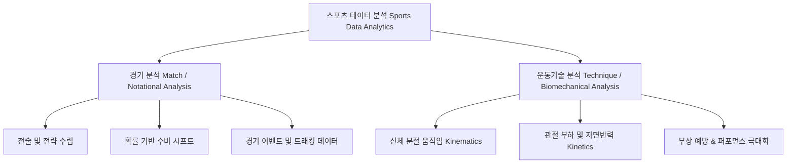
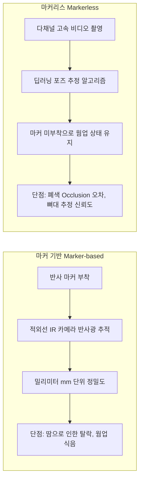
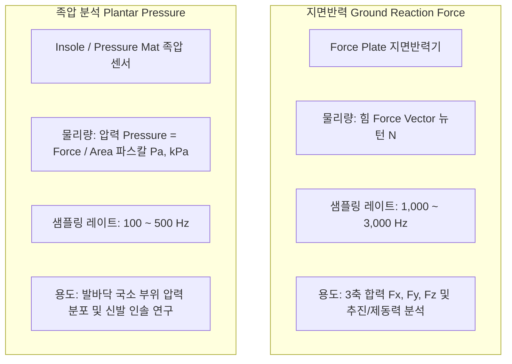

# 🏃‍♂️ 1회차: 스포츠 영상분석 기초 (Basics of Sports Video Analysis)

> **교육 일시**: 2026년 10월 10일 (토) 10:00 ~ 17:00 (총 7시간)  
> **강사**: 변경석 박사 (체육학 Ph.D / 現 벡터바이오 대표, KBO 두산 베어스·SSG 랜더스·삼성 라이온즈 바이오메카닉스 전담)  
> **장소**: 서울 송파구 올림픽공원 내 스포츠인재아카데미 2강의실  
> **정리자**: 이준형 (Junhyeong Lee)

---

## 📋 Table of Contents
1. [강의 개요 및 강사 소개](#1-강의-개요-및-강사-소개)
2. [세션 1: 스포츠 영상분석의 패러다임과 현장 도입](#2-세션-1-스포츠-영상분석의-패러다임과-현장-도입)
3. [세션 2: 운동기술분석 프로토콜 및 영상 수집 환경 구축](#3-세션-2-운동기술분석-프로토콜-및-영상-수집-환경-구축)
4. [세션 3: 생체역학(Biomechanics) 기초 이론 및 좌표계](#4-세션-3-생체역학biomechanics-기초-이론-및-좌표계)
5. [세션 4: 지면반력(GRF) vs 족압(Plantar Pressure) 분석 메커니즘](#5-세션-4-지면반력grf-vs-족압plantar-pressure-분석-메커니즘)
6. [현장 실무 핵심 인사이트 & Q&A](#6-현장-실무-핵심-인사이트--qa)
7. [향후 일정 및 조별 실습 안내](#7-향후-일정-및-조별-실습-안내)

---

## 1. 강의 개요 및 강사 소개

### 1.1 교육 배경 및 방향성
- **단순 툴 사용자가 아닌 '현장 솔루션을 제시하는 바이오메카닉스 분석가' 양성**
- 영상 분석 기술과 컴퓨터 비전 알고리즘이 고도화되어도, **선수와 지도자의 신체 움직임 및 운동 메커니즘에 대한 이해**가 부재하면 유의미한 분석 결과를 도출할 수 없음.
- 상용화된 분석 소프트웨어의 블랙박스 알고리즘에 의존하기보다, **원천 데이터의 물리적 의미(좌표계, 샘플링 레이트, 광학 조건, 역학적 공식)**를 직접 검증하고 통제할 수 있는 역량 배양.

### 1.2 강사 프로필
- **변경석 박사 (Ph.D in Biomechanics)**
  - 現 **벡터바이오 (VectorBio)** 대표이사
  - 現 **KBO 프로야구 구단(두산 베어스, SSG 랜더스, 삼성 라이온즈)** 바이오메카닉스 측정 및 분석 총괄
  - 現 한국여자야구연맹(WBAK) 부회장
  - 국내 프로야구 구단 1·2군 현장 투구/타격 모션 캡처 및 부상 예방·퍼포먼스 향상 시스템 실무 총괄

---

## 2. 세션 1: 스포츠 영상분석의 패러다임과 현장 도입

### 2.1 스포츠 데이터 분석의 이원화 구조



- **경기 분석 (Match / Notational Analysis)**:
  - 타구의 궤적, 슈팅 위치, 수비 위치 선정 등 경기 내 이벤트와 승패 확률에 초점을 맞춘 분석.
  - 예: 세이버메트릭스 기반의 수비 시프트(Shift), 점유율/패스 성공률 통계.
- **운동기술 분석 (Technique / Biomechanical Analysis)**:
  - 선수의 신체가 어떻게 힘을 생성하고 전달하는지 해부학적·역학적으로 추적.
  - 관절 각도, 각속도, 가속도, 토크, 지면반력 전달 효율을 분석하여 **부상 메커니즘 규명 및 운동 역량(구속, 비거리 등) 향상**에 직결.

### 2.2 글로벌 트렌드 및 KBO 현장 도입기
- **미국 드라이브라인(Driveline Baseball)의 등장**:
  - 초고속 카메라와 모션 캡처 장비를 활용하여 투수의 키네마틱 시퀀스(Kinematic Sequence)를 정량화하고, 가중치 볼(Weighted Ball) 트레이닝과 결합해 폭발적인 구속 향상을 증명.
- **KBO 프로구단 현장 도입**:
  - **SSG 랜더스 (강화 2군 훈련소) 및 두산 베어스** 프로젝트 진행.
  - 과거: 지도자의 정성적 감각에 의존 → 현재: 정밀 모션 캡처 기반 투구 메커니즘 진단.
  - **실제 사례**: 견갑골(Scapula) 가동성 저하로 팔꿈치에 과부하가 걸리던 투수에게 맞춤형 가동성 훈련 및 키네마틱 시퀀스 교정을 9주간 적용한 결과, **라이브 피칭 구속이 149km/h에서 151km/h로 증가**하며 부상 위험도 감소.

### 2.3 현장 커뮤니케이션의 철칙
> *"현장 코칭스태프의 눈(80%)과 측정 데이터(20%)가 결합할 때 진정한 변화가 일어납니다."*

- **현장 수용성(Buy-in)의 중요성**:
  - 분석가가 수백 페이지의 난해한 역학 데이터(Raw Numbers)를 그대로 전달하면 현장 지도자와 선수는 거부감을 느낌.
  - 현장 지도자가 육안으로 감지한 80%의 직관을 지지해주고, **눈으로 절대 확인할 수 없는 20%의 미세 오차(예: Foot Strike 시 골반-몸통 분리각 타이밍, 어깨 내회전 피크 시점)**를 직관적인 비주얼 그래프로 소통해야 함.
  - 종목의 고유 언어와 특성에 맞춘 시각화 보고서 커스터마이징 필수.

---

## 3. 세션 2: 운동기술분석 프로토콜 및 영상 수집 환경 구축

### 3.1 운동기술분석의 7단계 표준 프로세스

```text
[Step 1] 측정 목적 정의 (Why) ──▶ [Step 2] 변인 및 측정 도구 선정 (What & Tool)
           │
[Step 3] 환경 통제 및 캘리브레이션 (Calibration) ──▶ [Step 4] 동기화 촬영 및 데이터 수집
           │
[Step 5] 좌표계 변환 및 디지털 필터링 ──▶ [Step 6] 운동역학 변인 산출 (Kinematics/Kinetics)
           │
[Step 7] 결과지 작성 및 현장 솔루션 피드백 (Actionable Insight)
```

1. **측정 목적 정의 (가장 핵심)**:
   - "무엇을 해결하기 위해 측정하는가?" (예: 구속 저하 원인 규명, 토미존 수술 후 재활 복귀 판별 등). 목적 없는 측정은 데이터 쓰레기(Garbage)만 양산함.
2. **변인 및 측정 도구 선정**: 2D 비디오, 광학식 모션캡처, IMU 센서, 지면반력기, 족압기 중 최적의 도구 조합 결정.
3. **환경 통제 및 캘리브레이션**: 정밀 좌표계 구축 및 외부 오차 요인 차단.
4. **동기화 촬영**: 다채널 카메라 간 하드웨어/소프트웨어 프레임 동기화.
5. **좌표 변환 및 필터링**: 2D 픽셀 좌표 → 3D 실제 좌표(DLT 알고리즘 적용), 노이즈 제거(Butterworth Filter).
6. **역학 변인 산출**: 관절 중심점 기반 분절 각도, 각속도, 모멘트, 파워 계산.
7. **결과지 작성**: 직관적인 시각화 및 실행 가능한 솔루션 제시.

---

### 3.2 카메라 광학 파라미터 제어 이론

| 파라미터 | 권장 설정 및 주의사항 | 역학적 영향 및 트레이드오프 |
|:---|:---|:---|
| **해상도 (Resolution)** | FHD (1920×1080) ~ 4K 권장 | 고해상도일수록 마커 검출 정밀도가 올라가지만, 데이터 용량 및 고속 프레임 캡처 시 대역폭 제약 발생 |
| **프레임 레이트 (FPS)** | 야구 투구/타격: **300 FPS 이상**<br/>일반 보행/런닝: **60 ~ 120 FPS** | 프레임 수가 부족하면 볼 릴리즈(Ball Release)나 임팩트 순간이 프레임과 프레임 사이에 누락되는 에일리어싱(Aliasing) 발생 |
| **셔터 스피드 (Shutter Speed)** | 고속 동작: **1/1000초 ~ 1/2000초 이하** | 셔터가 느리면 잔상(**Motion Blur**)이 발생해 관절 좌표 추출 오차 급증. 셔터가 빠르면 빛이 부족하므로 **충분한 조도(룩스) 확보 필수** |
| **포커스 (Focus)** | **수동 초점 (Manual Focus) 고정** | 자동 초점(AF) 사용 시 선수의 이동이나 배경 움직임에 따라 포커스가 튀어 좌표 스케일이 왜곡됨 |
| **조리개 & 렌즈** | F2.8 ~ F4 권장, 왜곡 적은 단렌즈 | 광각 렌즈 사용 시 배럴 왜곡(Barrel Distortion)에 대한 렌즈 보정 알고리즘 적용 필수 |

---

### 3.3 공간 캘리브레이션(Calibration)의 절대성
- **캘리브레이션의 의미**:
  - 2차원 카메라 화면 상의 픽셀 좌표 $(u, v)$를 실제 3차원 물리 공간의 미터 좌표 $(X, Y, Z)$로 맵핑하기 위한 제어 프레임(Control Frame) 구축.
- **현장 주의사항**:
  - 카메라 설치 후 캘리브레이션 프레임을 촬영하고 나면, **카메라는 단 1mm도 이동하거나 진동해서는 안 됨**.
  - 관중이나 선수가 삼각대를 툭 치는 순간 기구축된 변환 행렬이 무효화되어 **당일 수집된 모든 데이터가 폐기**됨.
  - 삼각대 바닥 고정, 테이핑, 동선 통제는 테크니션의 필수 직업윤리.

---

### 3.4 모션 캡처 시스템 비교: 마커 기반 vs 마커리스



- **마커 기반 (Marker-based Motion Capture)**:
  - 인체 주요 해부학적 랜드마크에 반사 마커를 부착하여 추적.
  - *장점*: 현존 최고 수준의 정확도 (골드 스탠다드).
  - *단점*: 부착에 15~30분 소요되어 선수의 웜업이 식음. 피칭 시 땀으로 마커가 탈락하여 재부착해야 하는 현장 한계.
- **마커리스 (Markerless Motion Capture)**:
  - 딥러닝 기반 관절 위치 추정(Computer Vision Pose Estimation) 활용.
  - *장점*: 장비 부착 없이 유니폼 차림으로 실전 투구 가능, 현장 적용성 극대화.
  - *현재 과제*: 관절 회전(Internal/External Rotation)의 정밀 추정 및 마커 방식 대비 신뢰도 검증 지속 진행 중.

---

## 4. 세션 3: 생체역학(Biomechanics) 기초 이론 및 좌표계

### 4.1 단위계의 엄밀성: Radian vs Degree

$$\theta \text{ (rad)} = \frac{s \text{ (호의 길이)}}{r \text{ (반지름)}}, \quad 1 \text{ rad} \approx 57.2958^\circ$$

- 일상 코칭에서는 각도(Degree, $^\circ$)를 쓰지만, **운동역학적 속도/에너지 계산에서는 반드시 라디안(Radian)** 단위를 사용해야 함.
- 선속도와 각속도의 관계:
  $$v = r \cdot \omega \quad (v: \text{선속도 } [\text{m/s}], \; r: \text{회전반경 } [\text{m}], \; \omega: \text{각속도 } [\text{rad/s}])$$
- 분석 소프트웨어(Visual3D, Python, MATLAB)에서 삼각함수 연산 시 라디안/디그리 혼용으로 인한 계산 오류 방지 필수.

---

### 4.2 선운동학(Linear) vs 각운동학(Angular)

| 물리량 | 선운동학 (Linear Kinematics) | 각운동학 (Angular Kinematics) | 스포츠 분석 적용 예시 |
|:---|:---|:---|:---|
| **위치 / 변위** | 위치 $\vec{r}$, 변위 $\Delta \vec{r}$ [$\text{m}$] | 각위치 $\theta$, 각변위 $\Delta \theta$ [$\text{rad}$] | 보폭(Stride Length), 골반 회전 각도 |
| **속도** | 선속도 $\vec{v} = \frac{d\vec{r}}{dt}$ [$\text{m/s}$] | 각속도 $\vec{\omega} = \frac{d\theta}{dt}$ [$\text{rad/s}$] | 볼 릴리즈 속도, 몸통 회전 각속도, 전완 회내 속도 |
| **가속도** | 선가속도 $\vec{a} = \frac{d\vec{v}}{dt}$ [$\text{m/s}^2$] | 각가속도 $\vec{\alpha} = \frac{d\vec{\omega}}{dt}$ [$\text{rad/s}^2$] | 임팩트 시 클럽헤드 가속도, 어깨 내회전 각가속도 |

---

### 4.3 투구 동작의 국면 분할 (Pitching Phase & Event Detection)
야구 투구와 같은 고속 연속 동작은 단일 시점이 아닌 **이벤트(Event) 기반의 국면(Phase)**으로 나누어 분석해야 함:

```text
[1. Wind-up] ──▶ [2. Stride] ──▶ [3. Arm Cocking] ──▶ [4. Acceleration] ──▶ [5. Deceleration] ──▶ [6. Follow-through]
                       │                   │                     │
                  Foot Strike(FS)    Max External(MER)     Ball Release(BR)
```

1. **Wind-up (준비기)**: 투구 시작부터 앞발이 최고 높이에 도달할 때까지.
2. **Stride (보폭기)**: 앞발 하강부터 지면 착지(Foot Strike, FS) 시점까지. 지면반력 축적 및 전진 운동에너지 발생.
3. **Arm Cocking (코킹기)**: FS부터 어깨 최대 외회전(Maximum External Rotation, MER) 시점까지.
4. **Arm Acceleration (가속기)**: MER부터 볼 릴리즈(Ball Release, BR) 직전까지. 몸통 회전 에너지가 어깨, 팔꿈치, 손목으로 전이.
5. **Deceleration & Follow-through (감속기 및 팔로우스루)**: 공을 놓은 직후 신체 회전 에너지 흡수 및 감속. 후방 어깨/회전근개 부상 방지 중요 구간.

---

## 5. 세션 4: 지면반력(GRF) vs 족압(Plantar Pressure) 분석 메커니즘

> *"지면반력과 족압은 측정 원리와 물리적 단위가 완전히 다른 지표입니다."*



### 5.1 핵심 차이점 비교 분석

| 비교 항목 | 지면반력 (Ground Reaction Force, GRF) | 족압 (Plantar Pressure / Pedobarography) |
|:---|:---|:---|
| **측정 원리** | 스트레인 게이지(Strain Gauge) 또는 압전(Piezoelectric) 센서 기반 힘 벡터 측정 | 매트릭스 압력 센서(압전소자, 저항성 폴리머) 기반 면적당 접촉 압력 측정 |
| **물리량 및 단위** | **힘 (Force, $\text{N}$)**: 3차원 직교 좌표계 ($F_x, F_y, F_z$) | **압력 (Pressure, $\text{kPa}$)**: $\text{Pressure} = \frac{\text{Force}}{\text{Area}}$ |
| **샘플링 레이트** | **1,000 Hz ~ 3,000 Hz (초고속)** | 보통 **100 Hz ~ 500 Hz** |
| **주요 분석 변인** | • 수직 지면반력 피크 ($F_z$ Peak)<br/>• 제동력(Braking Force) 및 추진력(Propulsion Force)<br/>• 압력중심점 (Center of Pressure, COP) | • 부위별 접촉 면적 (Forefoot, Midfoot, Rearfoot)<br/>• 국소 부위 피크 압력 (Peak Pressure)<br/>• 압력 시간 적분치 (Pressure-Time Integral) |
| **현장 적용 분야** | • 투수/타자의 디딤발 제동 및 회전 모멘텀 전달 분석<br/>• 점프 착지 시 하지 관절 충격량 분석 | • 종목별 맞춤 스파이크/신발 인솔 설계<br/>• 당뇨발, 평발 보행 궤적 및 족저근막염 부상 진단 |

### 5.2 혼동하기 쉬운 포인트 정리
- **면적에 따른 압력 차이**:
  - 동일한 $100\text{ N}$의 지면반력이 작용하더라도, 접촉 면적이 넓으면 압력($\text{kPa}$)은 낮고, 스파이크 징 하나처럼 접촉 면적이 극도로 좁으면 압력은 수십 배로 폭증함.
  - 따라서 **전체 힘의 크기와 방향을 볼 때는 지면반력기**, **발바닥 어느 부위에 하중이 집중되는지 볼 때는 족압계**를 선택해야 함.

---

## 6. 현장 실무 핵심 인사이트 & Q&A

1. **"장비가 모든 것을 해결해주지 않는다"**:
   - 데이터 분석 알고리즘과 장비가 아무리 정밀해도, 촬영 시 셔터스피드 설정 실수로 블러가 발생하거나 캘리브레이션이 흔들리면 산출되는 모든 파생 변수는 거짓이 됨.
2. **현장형 분석가의 자질**:
   - 코칭스태프 및 선수와의 라포(Rapport) 형성.
   - 통계 그래프가 아닌 "선수의 퍼포먼스 향상과 통증 경감"이라는 명확한 목적의식 보유.
   - 비주얼 3D, 파이썬, 매트랩 등 원천 데이터 가공 도구를 자유자재로 핸들링할 수 있는 기술적 내공.

---

## 7. 향후 일정 및 조별 실습 안내

- **조별 실습 편성 (2일차 진행 예정)**:
  - 교육생 관심 분야에 따라 **5~6개 조** 구성:
    - 야구 투구/타격 분석 조
    - 보행(Gait) 및 재활/기능 움직임 조
    - 기타 스포츠 종목(골프, 라켓 종목 등) 분석 조
- **차회 강의 예고 (2회차 - 10.11 일요일)**:
  - **주제**: 스포츠영상분석 자료수집 이론
  - **세부 내용**: 다양한 고속 카메라와 센서를 활용한 영상 획득, 생체역학 & ICT & 스포츠과학 융합, 카메라 파라미터 및 촬영 프로토콜 실전 적용.

---

## 📁 부록: 강의 녹취 데이터 원문 아카이브

당일 7시간 동안 진행된 강사 강의 및 현장 Q&A 녹취 전사 파일은 아래 디렉토리에 보존되어 있습니다:
- [01_오전_오리엔테이션_현장사례.txt](./transcripts/01_morning_orientation_and_field_cases.txt) (75분 녹취)
- [02_오후_영상역학이론_카메라프로토콜.txt](./transcripts/02_afternoon_video_kinematics_theory.txt) (180분 녹취)
- [03_오후_지면반력_족압분석_총정리.txt](./transcripts/03_afternoon_grf_pedobarography_summary.txt) (8분 녹취)
