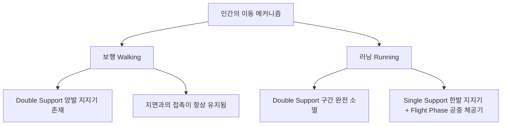
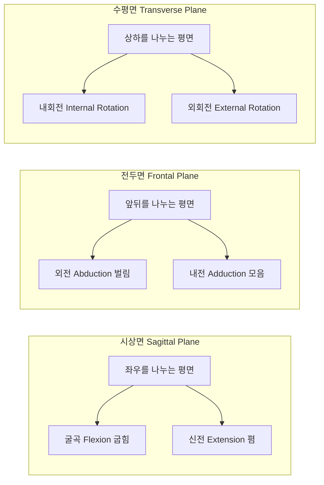
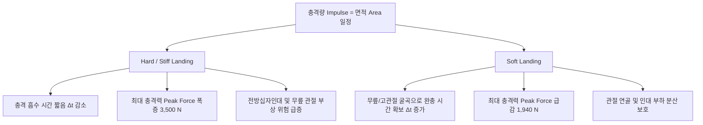

# 🏃‍♂️ 2회차: 스포츠영상분석 자료수집 이론 및 운동역학 심화 (Data Collection Theory & Advanced Biomechanics)

> **교육 일시**: 2026년 10월 11일 (일) 10:00 ~ 17:00 (총 7시간)  
> **강사**: 변경석 박사 (체육학 Ph.D / 現 벡터바이오 대표, KBO 두산 베어스·SSG 랜더스·삼성 라이온즈 바이오메카닉스 전담)  
> **장소**: 서울 송파구 올림픽공원 내 스포츠인재아카데미 2강의실  
> **정리자**: 이준형 (Junhyeong Lee)

---

## 📋 Table of Contents
1. [강의 개요 및 현장 패러다임 변화](#1-강의-개요-및-현장-패러다임-변화)
2. [세션 1: 보행 분석(Gait Analysis)과 비전 AI 포즈 추정](#2-세션-1-보행-분석gait-analysis과-비전-ai-포즈-추정)
3. [세션 2: 기능해부학적 기초 및 3D 신체 모델링 체계](#3-세션-2-기능해부학적-기초-및-3d-신체-모델링-체계)
4. [세션 3: 생체역학 물리 기초 (벡터, 토크, 인체 지레)](#4-세션-3-생체역학-물리-기초-벡터-토크-인체-지레)
5. [세션 4: 운동량(Momentum), 충격량(Impulse) 및 착지 역학](#5-세션-4-운동량momentum-충격량impulse-및-착지-역학)
6. [세션 5: 투구 바이오메카닉스 심화 & 각운동량 보존 법칙](#6-세션-5-투구-바이오메카닉스-심화--각운동량-보존-법칙)
7. [세션 6: 스포츠 영상분석 도구 실습 (Kinovea & Python)](#7-세션-6-스포츠-영상분석-도구-실습-kinovea--python)
8. [현장 실무 핵심 인사이트 & 분석가의 마인드셋](#8-현장-실무-핵심-인사이트--분석가의-마인드셋)
9. [향후 일정 안내 (3회차 예고)](#9-향후-일정-안내-3회차-예고)

---

## 1. 강의 개요 및 현장 패러다임 변화

### 1.1 교육 목표
- 스포츠 현장에서 영상 데이터를 수집하고 정량화하기 위한 **생체역학(Biomechanics) 핵심 물리 법칙**의 완전한 체화.
- 연구실(Laboratory) 중심의 사후 논문 작성용 데이터 분석에서 벗어나, **경기장 현장(Field)에서 15~20분 내로 즉각적인 피드백 리포트를 도출하는 실시간 분석 파이프라인** 이해.
- 오픈소스 컴퓨터 비전(OpenCV, Pose Estimation), 2D 동작분석 툴(Kinovea), 3D 모델링(Visual3D)의 유기적 연계.

### 1.2 연구실 분석 vs 현장 초고속 파이프라인
- **과거의 한계**: 수백 트라이얼의 모션 캡처 데이터를 수작업 디지타이징하고 수치화하는 데 며칠에서 몇 주가 소요되어 경기 현장 지도자에게 실시간 솔루션을 제공하지 못함.
- **최신 현장 트렌드 (실제 사례)**:
  - 일본 유명 야구 전문 크리에이터(구독자 약 90만 명)의 한·일 유소년 아카데미 훈련 시스템 비교 취재 당시, 전날 섭외 후 익일 오전 구장에 스타렉스 차량으로 모션 캡처 및 지면반력 측정 장비를 현장 세팅.
  - 현장 측정 직후 원천 데이터 정제 및 알고리즘 자동화를 통해 **측정 후 불과 15~20분 만에 바이오메카닉스 분석 리포트를 즉각 출력하여 브리핑 완료**.
  - 측정부터 리포팅, 장비 철수까지 반나절 만에 완결하는 고도화된 파이프라인이 현대 스포츠과학의 핵심 경쟁력임.

---

## 2. 세션 1: 보행 분석(Gait Analysis)과 비전 AI 포즈 추정

### 2.1 보행(Walking) vs 러닝(Running)의 역학적 정의
스포츠 현장 및 임상 재활에서 인간의 가장 기본적이면서도 고도화된 분석 대상은 **보행(Gait)** 동작임.



- **핵심 판별 기준**: 속도($v$)의 빠르고 느림이 아님! **더블 서포트(Double Support, 양발 지지기) 구간의 발생 유무**로 정의.
  - **보행 (Walking)**: `한 발 지지(Single Support) ➔ 양 발 지지(Double Support) ➔ 반대 발 지지(Single Support) ➔ 양 발 지지(Double Support)` 순환. 항상 최소 한 발 이상이 지면에 접촉.
  - **러닝 (Running)**: 더블 서포트가 전혀 없으며, `한 발 지지 ➔ 체공기(Flight Phase) ➔ 반대 발 지지 ➔ 체공기`로 전환.

### 2.2 보행 분석의 주요 이벤트 및 임상 지표
- **Heel Strike (발뒤꿈치 닿기)** ➔ **Foot Flat (발바닥 안착)** ➔ **Mid-stance (중간 입각기)** ➔ **Push-off / Toe-off (발가락 떼기)**.
- **주요 산출 변인**:
  - 케이던스(Cadence, 분당 보폭 수), 스트라이드 길이(Stride Length), 스텝 너비(Step Width).
  - 좌우 대칭성(Symmetry Index): 뇌졸중, 관절염, 스포츠 상해 재활 환자의 독립 보행 가능 여부 및 불균형 평가의 기준.

### 2.3 컴퓨터 비전 기반 오픈소스 포즈 추정(Pose Estimation)의 한계와 주의점
- **오픈소스 AI 모델(MediaPipe, YOLO-Pose 등)의 스포츠 적용 실태**:
  - 일상적인 속도의 보행이나 정적인 체조 동작은 훌륭하게 추적함.
  - **테니스 서브, 야구 투구, 배드민턴 스매시 등 고속 스포츠 동작**에서는 모션 블러와 빠른 프레임 전환으로 인해 관절 랜드마크가 심하게 튀는(Jittering & Occlusion) 현상 발생.
  - 모델 사이즈(Lightweight vs Heavy): 실시간성을 위한 가벼운 모델은 고속 스포츠에서 오차 급증. 스포츠 전용 데이터셋으로 파인 튜닝(Fine-tuning)된 모델 사용 필수.
- **카메라 촬영 평면(Plane)의 통제**:
  - 관절 각도(ROM: Range of Motion, 예: 고관절 외전/내전) 추정 시 **정면(Frontal Plane) 또는 측면(Sagittal Plane)** 등 대상 움직임의 주 평면과 카메라 광축이 직교하도록 철저히 환경 통제 필요.

---

## 3. 세션 2: 기능해부학적 기초 및 3D 신체 모델링 체계

### 3.1 해부학적 중립 자세(Anatomical Position)
- **정의**: 두 발을 모으거나 어깨너비로 벌리고 직립하여, 시선과 양 손바닥(Palms)을 정면을 향하게 편 상태.
- **모션 캡처에서의 중요성**:
  - 모든 분절 각도($0^\circ$)와 기준 좌표계의 원점 및 회전축을 정의하는 **정적 캘리브레이션 캡처(Static Trial)**의 절대 기준.
- **인간공학(Ergonomics)적 고찰**:
  - 일반 직사각형 키보드/마우스를 쥘 때 팔뚝은 해부학적으로 부자연스러운 과도한 회내(Pronation) 상태에 놓여 손목 터널에 지속적 부하를 줌.
  - 버티컬 마우스나 분리형 인체공학 키보드는 신체의 해부학적 중립 자세(Neutral Position)를 최대한 보존하기 위해 설계된 역학적 산물.

### 3.2 신체 방향성 용어와 상대성 (Relative Reference)

| 방향 용어 | 영문 명칭 | 정의 및 스포츠 분석 적용 |
|:---|:---|:---|
| **전방 / 후방** | **Anterior / Posterior** | 인체의 앞쪽 배면 / 뒤쪽 등면 |
| **상방 / 하방** | **Superior / Inferior** | 머리 쪽(위) / 발 쪽(아래) |
| **내측 / 외측** | **Medial / Lateral** | 인체 중심선(Midline) 기준 안쪽 / 바깥쪽 |
| **근위 / 원위** | **Proximal / Distal** | 몸통(체간) 중심에 가까운 쪽 / 먼 쪽 |

> ⚠️ **근위(Proximal)와 원위(Distal)의 상대성**:  
> 대퇴(Thigh) 분절 관점에서 **무릎(Knee)은 원위(Distal)** 관절이지만, 하퇴(Shank) 분절 관점에서는 **무릎(Knee)이 근위(Proximal)** 관절이 됨. 모델링 시 각 분절의 시작점(Proximal)과 끝점(Distal)을 소프트웨어(Visual3D)에 정확히 정의해야 역학적 관절 모멘트 계산이 왜곡되지 않음.

### 3.3 분절(Segment)과 관절(Joint) 모델링
- **분절 (Segment)**: 대퇴(Thigh), 하퇴(Shank), 족부(Foot), 상완(Upper Arm), 전완(Forearm), 수부(Hand), 몸통(Trunk), 골반(Pelvis) 등 질량과 관성모멘트를 갖는 강체(Rigid Body).
- **관절 (Joint)**: 고관절(Hip), 슬관절(Knee), 족관절(Ankle), 견관절(Shoulder) 등 두 개 이상의 분절이 만나 회전 운동이 발생하는 경계.
- **해부학적 랜드마크 마커 부착**:
  - 골반 정의를 위한 **ASIS (Anterior Superior Iliac Spine, 전상장골극)**, **PSIS (Posterior Superior Iliac Spine, 후상장골극)**의 정확한 촉지(Palpation)와 마커 부착이 3차원 골반 좌표계 형성의 성패를 결정.

### 3.4 3대 인체 운동 평면과 관절 동작



---

## 4. 세션 3: 생체역학 물리 기초 (벡터, 토크, 인체 지레)

### 4.1 스칼라(Scalar) vs 벡터(Vector)
- **스칼라 (Scalar)**: 크기(Magnitude)만 갖는 물리량 (시간, 질량, 이동거리, 스피드).
- **벡터 (Vector)**: 크기와 **방향(Direction)**을 모두 갖는 물리량 (변위, 속도, 가속도, 힘 $\vec{F}$, 토크 $\vec{\tau}$).
- **스포츠에서의 벡터 합성(Vector Composition)**:
  - 투구 및 타격 동작 시 하체, 골반, 몸통, 어깨, 팔꿈치에서 발생하는 모든 분절 힘 벡터의 최종 합성 방향이 **목표물(홈플레이트 방향)과 완벽하게 정렬(Alignment)**되어야 에너지 손실 없이 최대 구속을 생성함. 벡터 방향이 분산되면 비효율적 에너지 누수 발생.

---

### 4.2 회전력: 토크(Torque)와 모멘트 암(Moment Arm)

$$\vec{\tau} = \vec{r} \times \vec{F} = r \cdot F \cdot \sin(\theta)$$

- $\tau$: 토크 또는 회전력 ($\text{N}\cdot\text{m}$)
- $r$: 회전축으로부터 힘의 작용점까지의 거리 (모멘트 암, Moment Arm)
- $F$: 가해진 힘 ($\text{N}$)
- $\theta$: 힘의 방향과 모멘트 암 사이의 각도 ($\theta = 90^\circ$일 때 최대 효율)
- **현장 역학**:
  - 꽉 잠긴 볼트를 풀 때 긴 렌치(스패너)를 쓰면 적은 힘으로도 큰 토크를 낼 수 있듯이, 인체 관절 주변 건(Tendon)의 부착 거리와 분절 길이에 따라 발생하는 관절 토크가 결정됨.

---

### 4.3 인체 지레(Lever) 3대 시스템 완벽 비교

인체는 뼈(지렛대), 관절(회전축), 근육 수축(힘점), 신체 무게 및 외력(저항점)으로 구성된 정교한 지레 시스템임.

> 💡 **지레 암기 공식 (중간에 위치하는 요소 기준)**:  
> **1종 = 축(A) 중심** | **2종 = 저항(R) 중심** | **3종 = 힘(F) 중심**

```text
[1종 지레]   저항(R) ──────── 축 (Fulcrum/Axis) ──────── 힘(Force/Effort)
[2종 지레]   축 (Axis) ────── 저항 (Resistance) ──────── 힘(Force/Effort)
[3종 지레]   축 (Axis) ────── 힘 (Force/Effort) ──────── 저항 (Resistance)
```

| 지레 분류 | 중앙 요소 | 기계적 이득 (Mechanical Advantage) | 인체 및 일상 예시 | 스포츠 및 트레이닝 적용 |
|:---:|:---:|:---|:---|:---|
| **1종 지레** | **축 (A)** | • 힘과 거리의 균형<br/>• 힘의 방향 전환 | • 시소, 가위, 장도리<br/>• 머리 받침(환추후두관절) 끄덕임 | 머리의 밸런스 유지 및 자세 제어 |
| **2종 지레** | **저항 (R)** | • **힘의 극대화 (힘 이득)**<br/>• 거리 및 속도의 손해<br/>($\text{힘 암} > \text{저항 암}$) | • 손수레, 병따개<br/>• **까치발 들기(발목 족저굴곡)** | 자기 체중의 수 배를 들어 올리는 종아리 비복근·가자미근의 강력한 지면 추진력 |
| **3종 지레** | **힘 (F)** | • **속도 및 가동범위 극대화**<br/>• **힘의 손해 (큰 근력 필요)**<br/>($\text{힘 암} < \text{저항 암}$) | • 핀셋, 젓가락, 낚싯대<br/>• **팔꿈치 굴곡(이두근 컬)** | **인체 골격근의 대다수를 차지!** 작은 근수축으로 손·발끝을 초고속으로 회전시켜 투구, 킥, 스윙 속도 극대화 |

#### ❓ 왜 인체는 비효율적인 3종 지레가 대부분인가? (근비대 & 퍼포먼스)
- 3종 지레는 힘의 관점에서는 손해(무거운 무게를 들기 위해 근육이 엄청난 장력을 내야 함)이지만, **적은 근육 수축 변위로도 말초 분절(손, 발)을 폭발적인 속도와 광범위한 가동범위로 움직일 수 있음**.
- 스포츠의 본질(공 던지기, 달리기, 점프, 차기)은 **속도(Velocity)**에 있으므로, 인체는 속도 특화형인 3종 지레 구조로 진화함.
- 웨이트 트레이닝 시 모멘트 암이 길어질수록(저항암 증가) 목표 근육에 걸리는 부하 토크가 기하급수적으로 증가하여 근비대 자극에 유리함.

---

## 5. 세션 4: 운동량(Momentum), 충격량(Impulse) 및 착지 역학

### 5.1 선운동량과 충격량의 역학적 관계

$$\text{선운동량: } \vec{p} = m \cdot \vec{v} \quad [\text{kg}\cdot\text{m/s}]$$

$$\text{충격량: } \vec{I} = \int_{t_1}^{t_2} \vec{F} \, dt = \vec{F}_{\text{avg}} \cdot \Delta t = \Delta \vec{p} = m \vec{v}_2 - m \vec{v}_1 \quad [\text{N}\cdot\text{s} = \text{kg}\cdot\text{m/s}]$$

- 충격량은 **운동량의 변화량($\Delta p$)**과 정확히 일치함.
- 단위의 엄밀성: $\text{N}\cdot\text{s} = (\text{kg}\cdot\text{m/s}^2) \cdot \text{s} = \text{kg}\cdot\text{m/s}$ (두 단위는 물리적으로 완전히 동일).

---

### 5.2 힘-시간 곡선(Force-Time Curve)과 상해 예방



- **실제 벡터바이오 실험실 데이터 검증 (동일 높이 점프 착지)**:
  - **하드 랜딩 (Stiff Landing)**: 무릎을 빳빳하게 펴고 착지 ➔ 충격 시간 짧음 ➔ **최대 충격력 약 3,500 N** 기록.
  - **소프트 랜딩 (Soft Landing)**: 무릎과 고관절을 충분히 굽히며 착지 ➔ 충격 시간 연장 ➔ **최대 충격력 약 1,940 N ~ 2,000 N** (약 40% 이상 피크 부하 감소).
  - 총 충격량(곡선 하단 면적)은 동일하지만, **피크 힘을 낮추는 착지 전략이 전방십자인대(ACL) 파열 방지의 핵심**.

---

## 6. 세션 5: 투구 바이오메카닉스 심화 & 각운동량 보존 법칙

### 6.1 투구의 파워 에어리어(Power Area)와 익스텐션(Extension)
- **힙 드라이브 (Hip Drive)**:
  - 일반인/사회인 야구 투수: 와인드업 시 중심을 잃을까 두려워 무릎을 뒤로 빼며 주저앉음.
  - 엘리트/프로 투수: 무릎을 들어 올림과 동시에 골반을 홈플레이트 전방으로 과감하게 밀어 넣는 **힙 드라이브**로 전진 운동에너지 극대화.
- **파워 에어리어 (Power Area)**:
  - 지지면(Base of Support)을 넓게 확보한 상태에서 상체가 흔들림 없이 안정적으로 진입하여 지면반력을 상체 회전력으로 전환할 수 있는 전방 공간.
- **익스텐션 (Extension, 약 1.8m)**:
  - 릴리즈 포인트가 마운드 투구판 앞쪽으로 얼마나 멀리 전진했는가의 척도. 파워 에어리어가 확보되어야 긴 익스텐션 상태에서도 높은 타점과 폭발적인 구속이 유지됨.

---

### 6.2 각운동량 보존 법칙 (Conservation of Angular Momentum)

$$L = I \cdot \omega = \text{Constant} \quad (\text{외력이 작용하지 않을 때})$$

$$I = \sum m_i r_i^2 \quad (I: \text{관성모멘트}, \; \omega: \text{각속도})$$

- **피겨 스케이팅 스핀 원리**:
  - 팔을 몸쪽으로 모으면 회전축으로부터의 거리 $r \downarrow \rightarrow I \downarrow \rightarrow$ 각속도 $\omega \uparrow$ (초고속 회전).
  - 팔을 벌리면 $r \uparrow \rightarrow I \uparrow \rightarrow \omega \downarrow$ (회전 감속).
- **야구 투구 적용**:
  - 투구 시 비투구측 **글러브 팔(Glove Arm)**을 가슴 쪽으로 강하게 끌어당겨(Tuck) 상체의 관성모멘트($I$)를 줄임으로써 **몸통의 폭발적인 체간 회전 각속도($\omega$)를 유도**.
  - 글러브 팔이 바깥으로 벌어지면 관성모멘트가 커져 몸통이 일찍 열리는(Early Trunk Opening) 결함 발생.

---

### 6.3 구종별 투구 부하와 부상의 진실 (Fastball vs Breaking Ball)
현장 코칭스태프와 대중의 흔한 오해: *"변화구(커브, 슬라이더)가 팔꿈치를 비틀기 때문에 직구보다 훨씬 부상 위험이 높다?"*

```text
[바이오메카닉스 연구 및 센서 측정 팩트]
1. 팔꿈치 내측측부인대(UCL) 토크 및 어깨 관절 최대 부하는 
   '100% 전력 투구하는 패스트볼(Fastball)'에서 가장 높게 나타남.
2. 변화구에서 발생하는 부상의 본질:
   구종 자체의 문제라기보다, 손가락 그립과 회전 감각이 덜 발달된 상태에서 
   팔꿈치나 손목을 억지로 비틀어 꺾어 던질 때 발생하는 비정상적 전단력(Shear Force).
```

- **피치 카운트(Pitch Count) 관리의 고도화**:
  - 단순히 투구 수 100개를 일률적으로 카운트하는 것을 넘어, 구종별·피로도별 관절 토크 가중치를 부여하는 스마트 투구 관리 시스템의 필요성 제기.

---

## 7. 세션 6: 스포츠 영상분석 도구 실습 (Kinovea & Python)

### 7.1 Kinovea (키노베아) 2D 영상분석 소프트웨어
- **특징**: 전 세계 스포츠 지도자 및 연구자가 가장 널리 사용하는 무료 오픈소스 2D 비디오 분석 도구.
- **주요 기능**:
  - 듀얼 비디오 재생 및 동기화 비교.
  - 관절 궤적 추적(Trajectory Tracking), 정지 프레임 각도 및 거리 측정.
  - 스톱워치 그리드 및 시각적 주석(Annotation) 삽입.
- **현장 실습 케이스**:
  - **스쿼트(Squat) 분석**: 고관절·슬관절 가동범위(ROM), 하강/상승 구간별 굴곡 각속도 산출.
  - **보행 및 러닝(Running) 분석**: 발목 착지 각도, 좌우 보폭 비대칭성 및 케이던스 추출.
  - **투구(Pitching) 이벤트 분석**: Foot Strike, Max External Rotation, Ball Release 주요 국면 정지 및 코멘트 리포트 템플릿 생성.

---

### 7.2 파이썬(Python) 기반 분석 자동화 파이프라인 데모
- 강사가 자체 개발한 Python 기반 툴 시연:
  - 축구 경기장 탑뷰 호모그래피(Homography) 캘리브레이션: 코너플래그 및 페널티 박스 기준점을 픽셀 좌표에 매핑하여 실제 필드 좌표계로 변환.
  - 관절 각도 자동 산출 및 GUI 인터페이스를 통한 실시간 피드백 시스템.

---

### 7.3 종목별 영상분석 현장 실무 사례 아카이브
1. **필드하키 페널티 코너 (Penalty Corner)**:
   - 경기 중 재촬영이 절대 불가능한 극한의 단발성 상황. 단 한 번의 기회에서 다채널 고속 촬영을 완벽히 동기화하여 드래그 플릭(Drag Flick) 슈팅 메커니즘 분석.
2. **사이클 (Cycling) 정밀 피팅**:
   - 페달링 최하점(BDC)에서의 무릎 굴곡 각도($25^\circ \sim 35^\circ$)를 정밀 추적하여 최적의 안장 높이 세팅 및 무릎 전방 통증 예방.
3. **라켓 스포츠 (테니스/배드민턴) AI 데이터셋 구축 (과기부·NIA 대형 과제)**:
   - 6개월간 30여억 원 규모의 대형 국책 과제(벡터바이오 컨소시엄) 수행.
   - 테니스 매칭 앱(스매시 등)의 실력 레벨링 및 스윙 궤적/키네마틱 시퀀스 정량화.

---

## 8. 현장 실무 핵심 인사이트 & 분석가의 마인드셋

> 🗣️ *"내가 궁금한 것을 분석해서 전달하지 말고, 현장 지도자와 선수가 진짜 궁금해하는 갈증을 해결해 주어야 합니다."*

1. **분석 결과지는 '성적표'가 아니라 '대화의 도구'**:
   - 숫자로 가득 찬 100페이지짜리 역학 논문은 현장에서 버려짐.
   - 선수의 폼을 지적하고 평가하는 채점관이 아니라, "어떻게 하면 구속을 2km/h 더 올리고 팔꿈치 통증을 없앨 수 있을까?"를 함께 고민하는 파트너가 되어야 함.
2. **환경 제어와 데이터 정제 역량**:
   - 아무리 AI가 발전해도, 현장에서 삼각대가 흔들리거나 셔터스피드 세팅이 틀려 블러가 생기면 알고리즘은 무용지물임.
   - 예외 상황(Exception)을 스스로 디버깅하고 제어할 수 있는 탄탄한 코드 작성 능력과 도메인 지식의 융합 필수.

---

## 9. 향후 일정 안내 (3회차 예고)

- **차회 강의 (3회차 - 2026. 10. 17. 토요일 10:00~17:00)**:
  - **주제**: 스포츠영상분석 자료수집 및 가공 (2차원)
  - **세부 내용**:
    - Kinovea 및 고속 카메라를 활용한 **2차원 정성적·정량적 분석** 실습
    - 2D 영상 데이터 좌표 추출, 노이즈 필터링 및 데이터 가공 파이프라인 실전
