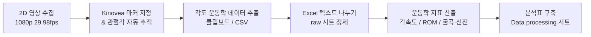

# 🏃‍♂️ 3회차: 스포츠영상분석 자료수집 및 가공 (2차원) (2D Data Collection & Processing)

> **교육 일시**: 2026년 10월 17일 (토) 10:00 ~ 17:00 (총 7시간)  
> **강사**: 변경석 박사 (체육학 Ph.D / 現 벡터바이오 대표, KBO 두산 베어스·SSG 랜더스·삼성 라이온즈 바이오메카닉스 전담)  
> **장소**: 서울 송파구 올림픽공원 내 스포츠인재아카데미 2강의실  
> **정리자**: 이준형 (Junhyeong Lee)  
> **사용 도구**: Kinovea (v0.9.5 2D 모션 분석), Microsoft Excel (운동학 데이터 가공 및 분석표 작성)  
> **실습 영상 및 동작**: 스쿼트 (Squat) 측면 촬영 영상 (1920×1080 @ 29.98 fps)

---

## 📋 Table of Contents
1. [오늘의 학습 목표 및 분석 파이프라인](#1-오늘의-학습-목표-및-분석-파이프라인)
2. [세션 1: Kinovea 2D 관절각 측정 및 트래킹 (Tracking)](#2-세션-1-kinovea-2d-관절각-측정-및-트래킹-tracking)
3. [세션 2: 운동학(Kinematics) 데이터 내보내기 및 툴 설정](#3-세션-2-운동학kinematics-데이터-내보내기-및-툴-설정)
4. [세션 3: Excel 데이터 가져오기 및 전처리 (Raw Data)](#4-세션-3-excel-데이터-가져오기-및-전처리-raw-data)
5. [세션 4: 생체역학 핵심 지표 및 계산 알고리즘](#5-세션-4-생체역학-핵심-지표-및-계산-알고리즘)
6. [세션 5: 분석표(Squat Analysis Table) 구축 및 시트 간 연동](#6-세션-5-분석표squat-analysis-table-구축-및-시트-간-연동)
7. [세션 6: 현장 트러블슈팅 및 분석 팁](#7-세션-6-현장-트러블슈팅-및-분석-팁)
8. [오늘의 정리 및 차회(4회차) 일정 안내](#8-오늘의-정리-및-차회4회차-일정-안내)

---

## 1. 오늘의 학습 목표 및 분석 파이프라인



- **핵심 목표**:
  1. 오픈소스 영상분석 도구 **Kinovea**를 활용하여 스쿼트 동작 중 **무릎(Knee)·발목(Ankle) 관절각**을 프레임 단위로 정밀 추출.
  2. 추출된 시계열 운동학 데이터를 **Microsoft Excel**로 연동하여 **각속도(Angular Velocity)** 및 **관절 가동범위(ROM, Range of Motion)** 계산.
  3. 실무형 분석 템플릿인 **스쿼트 동작 분석표(Squat Analysis Table)**를 `raw` 시트와 `Data processing` 시트 간 참조 구조로 구축.

---

## 2. 세션 1: Kinovea 2D 관절각 측정 및 트래킹 (Tracking)

### 2.1 마커 부착 위치 및 각도 도구 (Angle Tool) 설정
- 피험자의 주요 해부학적 랜드마크(엉덩관절, 무릎관절, 발목관절, 발끝)에 부착된 **빨간색 반사 마커**를 기준점으로 활용.
- 하단 툴바의 **각도 도구(Angle Tool)**를 사용하여 3개의 키포인트를 지정하여 관절각 생성:
  - **무릎 각도 (Knee Angle)**: 엉덩이 (Hip) – 무릎 (Knee) – 발목 (Ankle)
  - **발목 각도 (Ankle Angle)**: 무릎 (Knee) – 발목 (Ankle) – 발끝 (Toe)

```text
[엉덩이 (Hip)]
     \
      \  (대퇴 분절)
       \
    [무릎 (Knee)] ◀── 무릎 관절각
       /
      /  (하퇴 분절)
     /
[발목 (Ankle)] ◀── 발목 관절각
     \
      \  (발 분절)
    [발끝 (Toe)]
```

### 2.2 자동 추적(Tracking) 및 프레임 보정
1. 생성된 각도 도구 위에서 **우클릭 → [추적하는것] → [추적 시작]** 선택.
2. 영상을 순방향 재생하면 각 프레임마다 마커를 추적 알고리즘이 자동으로 트래킹하며 시계열 각도 데이터 누적 기록.
3. 고속 동작이나 신체 분절 겹침(Occlusion) 등으로 인해 추적 포인트가 마커에서 이탈할 경우:
   - 해당 프레임에서 일시정지 후 점을 마우스 드래그로 올바른 마커 위치에 수동 보정.

> 💡 **실무 네이밍 팁**: 각도 라벨 기본값(`각도 1`, `각도 2`)을 우클릭 속성에서 `Knee`, `Ankle`로 변경해두면 엑셀 데이터 추출 시 열 구분이 용이함.

---

## 3. 세션 2: 운동학(Kinematics) 데이터 내보내기 및 툴 설정

### 3.1 각도 운동학(Angular Kinematics) 창
- **접근 경로**: 상단 `도구들` 메뉴 또는 우측 도구 패널의 **그래프 아이콘** 클릭 → **[각도 운동학들]** 창 활성화.

| 설정 항목 | 권장 설정값 | 비고 및 설명 |
|:---|:---|:---|
| **자료 원천 (Data Source)** | 내보낼 각도 항목 체크 (`Knee`, `Ankle`) | 다중 관절 동시 선택 가능 |
| **자료 (Data Type)** | `각도 (Angle)` 또는 `각속도 (Angular Velocity)` | 각속도 자체 추출 가능 |
| **시간 (Time)** | `절대적 (Absolute)` | 프레임 절대 시각 기준 |

### 3.2 UI 번역 대응 가이드 (Kinovea 한글화 주의사항)
Kinovea의 한국어 리소스 팩 번역이 직관적이지 않으므로 아래 대응표 숙지 필수:

| 화면 한글 번역 UI | 실제 영문 원문 | 기능 및 권장 사용법 |
|:---|:---|:---|
| **종이고정철사판에 복사하십시오** | *Copy to Clipboard* | **클립보드 복사 (추천 ⭐)**: 복사 후 엑셀에서 `Ctrl + V` 실행 시 열이 자동 분리되어 즉시 작업 가능 |
| **서류를위해 구하십시오** | *Save to File* | **파일로 저장**: CSV 파일 형식으로 로컬 저장 |
| **그림 내보내기** | *Export Image* | 화면 상의 각도/속도 그래프 시각화 이미지 캡처 저장 |
| **자료를 내보내기** | *Export Data* | 시계열 수치 원천 데이터(Numbers) 내보내기 |

> 💡 **Kinovea 필터링 알고리즘 참고**:  
> Kinovea는 소프트웨어 내부적으로 각속도를 계산할 때 노이즈 저감을 위한 자체 **스무딩(Smoothing, 저역통과 필터링)**을 적용함.  
> 따라서 엑셀에서 원시 각도(Raw Angle)를 바탕으로 수동 중앙차분 계산한 수치와 미세한 차이가 발생할 수 있으며, 실무에서는 필터링이 적용된 Kinovea의 `각속도` 데이터를 활용하는 것이 잡음 제거 측면에서 유리함.

---

## 4. 세션 3: Excel 데이터 가져오기 및 전처리 (Raw Data)

### 4.1 CSV 텍스트 나누기 (Text to Columns)
CSV 파일로 저장하여 Excel에서 열 경우, 쉼표(`,`) 구분이 적용되지 않고 **A열 한 셀에 데이터가 병합되어 표시**되는 현상 발생.

1. `A열` 전체 열 선택.
2. 상단 메뉴 **[데이터] → [텍스트 나누기]** 실행.
3. **1단계**: `구분 기호로 분리됨(D)` 선택 → [다음].
4. **2단계**: 기존 `탭` 체크 해제, **`쉼표(C)` 체크**, 텍스트 한정자를 큰따옴표(`"`)로 지정 → [마침].
5. 수치 데이터가 텍스트 형식으로 인식된 경우(셀 좌상단 초록색 삼각형 경고 표시):
   - 해당 범위 선택 후 경고 아이콘(⚠️) 클릭 → **[숫자로 변환]** 실행.

### 4.2 Raw 데이터 시트 구조 (`raw`)

| 열 | 변인명 | 단위 (Unit) | 비고 |
|:---:|:---|:---:|:---|
| **A** | 시간 (Time) | `ms` (천분의 일초) | 29.98 fps 기준 약 33.36 ms 간격 |
| **B** | 무릎 각도 (Knee Angle) | `deg (°)` | 대퇴-하퇴 사이 관절각 |
| **C** | 발목 각도 (Ankle Angle) | `deg (°)` | 하퇴-발 사이 관절각 |
| **D** | 무릎 각속도 (Knee Angular Velocity) | `deg/s` | Kinovea 필터링 적용 각속도 |
| **E** | 발목 각속도 (Ankle Angular Velocity) | `deg/s` | Kinovea 필터링 적용 각속도 |

---

## 5. 세션 4: 생체역학 핵심 지표 및 계산 알고리즘

### 5.1 각속도 (Angular Velocity, $\omega$, $\text{deg/s}$)
관절 각도가 시간에 따라 회전하는 속도 및 변화율.

$$\omega = \frac{\Delta \theta}{\Delta t} = \frac{\theta_{i+1} - \theta_{i-1}}{t_{i+1} - t_{i-1}}$$

- **Excel 수동 계산 공식 (중앙차분법, Central Difference Method)**:
  ```excel
  =(B4 - B2) / ((A4 - A2) / 1000)
  ```
  - 시간 단위가 밀리초($\text{ms}$)이므로 초($\text{s}$) 단위 환산을 위해 `/ 1000` 적용.
  - 양 끝단(첫 행 및 마지막 행)은 전후 데이터가 없으므로 계산에서 제외(빈칸 유지).

### 5.2 관절 운동 방향성: 굴곡(Flexion) vs 신전(Extension)

| 운동 구분 | 해부학적 정의 | 스쿼트 동작 국면 | 각속도 부호 규약 |
|:---|:---|:---|:---:|
| **굴곡 (Flexion)** | 관절 각도가 **작아지는** 움직임 | 하강 국면 (Descent Phase) | **음수 ($-$)** |
| **신전 (Extension)** | 관절 각도가 **커지는** 움직임 | 상승 국면 (Ascent Phase) | **양수 ($+$)** |

- **최대 굴곡 각속도 (Peak Flexion Velocity)**: 굴곡 방향으로 가장 빠른 속도 $\rightarrow$ 음수 영역의 극솟값이므로 `MIN()` 수식 산출.
- **최대 신전 각속도 (Peak Extension Velocity)**: 신전 방향으로 가장 빠른 속도 $\rightarrow$ 양수 영역의 극댓값이므로 `MAX()` 수식 산출.

### 5.3 관절 가동범위 (ROM, Range of Motion)
동작 전체 주기 동안 관절이 움직인 최대 각도 폭.

$$\text{ROM} = \theta_{\max} - \theta_{\min}$$

```excel
=MAX(각도범위) - MIN(각도범위)
```

---

## 6. 세션 5: 분석표(Squat Analysis Table) 구축 및 시트 연동

원천 데이터의 무결성을 보장하기 위해 **원시 데이터(`raw` 시트)**와 **요약 리포트(`Data processing` 시트)**를 명확히 분리하여 시트 간 참조 수식 적용.

### 6.1 분석표 레이아웃 및 기준 예시 데이터 (강사 시연 기준)

```text
================ [ Squat Analysis Summary ] ================

[ 최대 각속도 (deg/sec) ]
-----------------------------------------------------------
   관절 (Joint)   |     굴곡 (Flexion)     |   신전 (Extension)
------------------+------------------------+-----------------
    무릎 (Knee)   |        -105.8          |       90.7
    발목 (Ankle)  |         -41.9          |       28.9

[ 관절 가동범위 (ROM, deg) ]
-----------------------------------------------------------
    무릎 (Knee)   |          86.7
    발목 (Ankle)  |          19.6
===========================================================
```

### 6.2 시트 간 동적 참조 수식 (`Data processing` 시트 작성)

```excel
// [1] 관절 가동범위 (ROM) 산출
무릎 ROM  : =MAX(raw!B2:B357) - MIN(raw!B2:B357)
발목 ROM  : =MAX(raw!C2:C357) - MIN(raw!C2:C357)

// [2] 최대 각속도 (Peak Angular Velocity) 산출
무릎 굴곡 피크 : =MIN(raw!D2:D357)
무릎 신전 피크 : =MAX(raw!D2:D357)
발목 굴곡 피크 : =MIN(raw!E2:E357)
발목 신전 피크 : =MAX(raw!E2:E357)
```
> ※ 참조 범위의 마지막 행 번호(예: `B357`, `E357`)는 수집된 개별 영상의 총 프레임 수에 맞추어 지정.

### 6.3 리포트 서식 표준화
- 테이블 헤더: `병합하고 가운데 맞춤` 및 음영(Light Gray) 처리.
- 데이터 수치: 셀 서식에서 `자릿수 줄임`을 통해 소수점 첫째 자리(`0.0`)로 통일.
- 전체 데이터 테이블 외곽선 및 격자 테두리 적용.

---

## 7. 세션 6: 현장 트러블슈팅 및 분석 팁

### 7.1 각도 데이터가 음수(Negative)로 산출되는 현상
- **발생 원인**: Kinovea 각도 측정 도구를 생성할 때 3개 포인트를 찍는 **회전 방향(시계방향 vs 반시계방향)**에 따라 내부 부호 극성이 반전됨 (예: 정상적인 $95^\circ$가 $-163^\circ \rightarrow -85^\circ \rightarrow -168^\circ$와 같이 음수로 역산).
- **역학적 영향 평가**:
  - **관절 가동범위(ROM)**: `MAX - MIN` 연산 특성상 부호가 반전되어도 폭(Range) 자체는 **동일하게 유지**되어 영향 없음.
  - **각속도 부호**: 굴곡 시 각도가 증가하는 것으로 인식되어 **부호가 정반대(+/- 역전)**로 표기됨 (굴곡이 $+$, 신전이 $-$로 표시).
- **현장 해결 솔루션**:
  1. **엑셀 수식 보정**: 각속도 추출 시 수식에 마이너스 부호를 반전 적용.
     ```excel
     무릎 굴곡 피크 : =-MAX(raw!D2:D357)
     무릎 신전 피크 : =-MIN(raw!D2:D357)
     ```
  2. **Kinovea 재측정**: 각도 도구를 반대 방향 순서로 다시 작도하여 트래킹 재수행.

### 7.2 관절 라벨 혼동 방지 휴리스틱 (무릎 vs 발목 판별)
- 데이터 라벨이 뒤섞인 경우 관절 가동범위(ROM)의 물리적 크기로 신속히 구분:
  - **무릎 관절(Knee)**: 스쿼트 시 대퇴골의 대폭 회전으로 인해 **ROM 변화폭이 큼 (일반적으로 약 80° ~ 100°)**.
  - **발목 관절(Ankle)**: 족관절 배굴(Dorsiflexion)/저굴(Plantarflexion) 한계로 인해 **ROM 변화폭이 작음 (일반적으로 약 15° ~ 25°)**.

---

## 8. 오늘의 정리 및 차회(4회차) 일정 안내

### 8.1 3회차 핵심 성과 체크리스트
- [x] Kinovea 2D 각도 도구 배치 및 프레임별 키포인트 트래킹 완료
- [x] 각도 운동학(Angular Kinematics) 창을 통한 시계열 수치 데이터 내보내기 숙달
- [x] CSV 원시 데이터의 Excel 텍스트 나누기 및 자료형 변환 완료
- [x] 각속도, 관절 가동범위(ROM), 굴곡/신전 극성 역학 개념 체화
- [x] `raw` 시트와 `Data processing` 시트 연동을 통한 표준 스쿼트 분석표 템플릿 완성

### 8.2 4회차 (10.18 일요일) 예고
- **교육 주제**: **스포츠영상분석 결과지 작성 (2차원)**
- **실습 계획**:
  - 오늘 산출한 관절 운동학 분석표(ROM, 각속도, 시계열 그래프)를 기반으로 **현장 코칭스태프 및 선수가 직관적으로 이해할 수 있는 2차원 스포츠영상분석 표준 결과지(Report)** 작성 실습 진행.
  - 조별 실습 촬영 및 데이터 전처리-결과지 도출 실전 워크플로우 수행.

---
> 📌 *참고: 실습에 사용된 스쿼트 원본 영상 및 엑셀 데이터 세트는 차후 안내 및 업데이트 예정.*