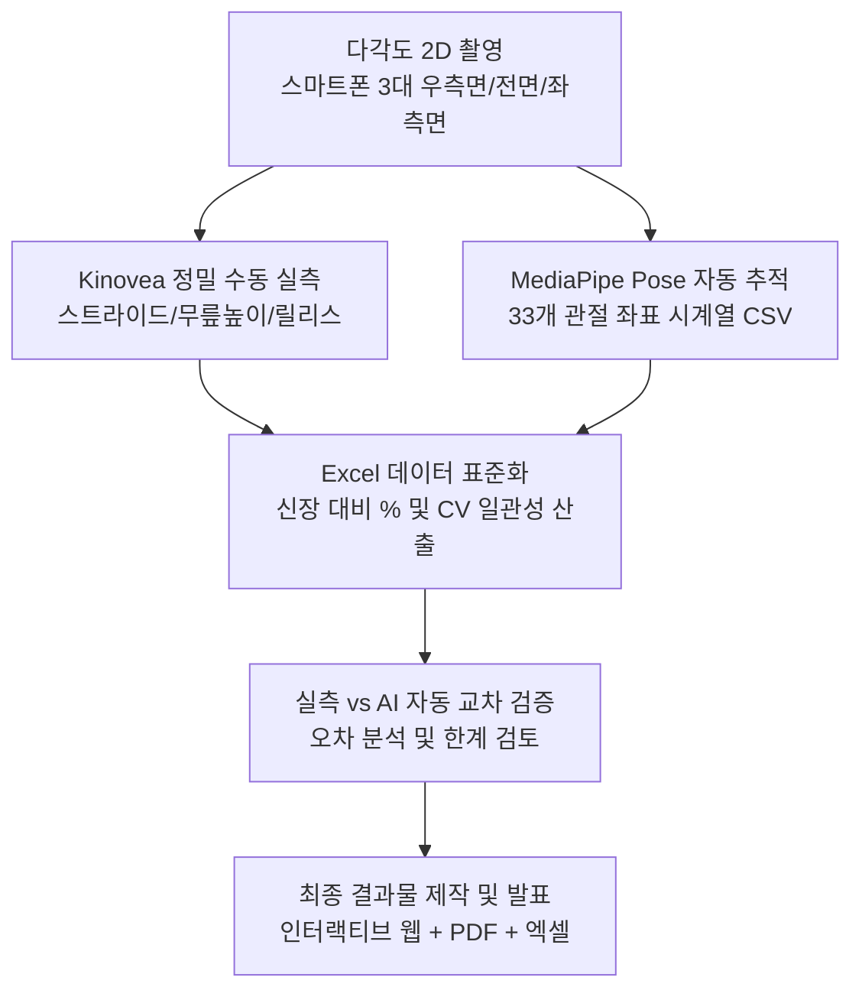

# 🏃‍♂️ 4회차: 스포츠영상분석 결과지 작성 (2차원) — 야구 투구 동작 비교분석 (2D Analysis Report)

> **교육 일시**: 2026년 10월 18일 (일) 10:00 ~ 17:00 (총 7시간)  
> **강사**: 변경석 박사 (체육학 Ph.D / 現 벡터바이오 대표, KBO 두산 베어스·SSG 랜더스·삼성 라이온즈 바이오메카닉스 전담)  
> **장소**: 서울 송파구 올림픽공원 내 스포츠인재아카데미 2강의실  
> **정리자**: 이준형 (Junhyeong Lee)  
> **사용 도구**: Kinovea (수동 정밀 실측), MediaPipe Pose (Python 키포인트 추출), Microsoft Excel, HTML/SVG 인터랙티브 대시보드  
> **실습 동작**: 야구 투구 (Pitching) · 대상 3명 (이상민, 신정환, 이준형) · 투구 5회 · 카메라 3대 (우측면·전면·좌측면)  
> **조별 발표**: 3조 투구동작 2D 비교분석 성과 발표 완료 📣

---

## 📋 Table of Contents
1. [오늘의 학습 목표 및 분석 파이프라인](#1-오늘의-학습-목표-및-분석-파이프라인)
2. [세션 1: 2D 투구 영상 수집 및 다각도 촬영 설계](#2-세션-1-2d-투구-영상-수집-및-다각도-촬영-설계)
3. [세션 2: 정량적 측정 지표 체계 (수동 실측 vs AI 자동 측정)](#3-세션-2-정량적-측정-지표-체계-수동-실측-vs-ai-자동-측정)
4. [세션 3: Kinovea 실측 프로토콜 및 데이터 정제](#4-세션-3-kinovea-실측-프로토콜-및-데이터-정제)
5. [세션 4: 3인 투구 메커니즘 비교분석 결과 및 생체역학적 해석](#5-세션-4-3인-투구-메커니즘-비교분석-결과-및-생체역학적-해석)
6. [세션 5: 산출물 아카이브 및 인터랙티브 사이트](#6-세션-5-산출물-아카이브-및-인터랙티브-사이트)
7. [세션 6: 2D 분석의 한계 및 현장 인사이트](#7-세션-6-2d-분석의-한계-및-현장-인사이트)
8. [오늘의 정리 및 차회(5회차 - 3차원 분석) 일정 안내](#8-오늘의-정리-및-차회5회차---3차원-분석-일정-안내)

---

## 1. 오늘의 학습 목표 및 분석 파이프라인

- **핵심 목표**:
  1. 투구 동작을 **측면·전면 2D 다각도 영상**으로 촬영하고, 사람이 직접 측정한 정밀 실측값(Kinovea)과 자동 추출값(MediaPipe Pose)을 결합하여 **3인 비교분석 결과지** 완성.
  2. 단순 관절 각도뿐만 아니라 투구 메커니즘을 결정짓는 **핵심 길이 지표(스트라이드 SFC, 최대 무릎 높이 MKH, 릴리스 높이 BR)**를 신장 대비 백분율(%)로 표준화.
  3. 조별 실습 성과물을 **인터랙티브 대시보드 웹앱([`04_pitching/`](./04_pitching/)), 종합 결과지 PDF, 원천 엑셀 분석표**로 제작하여 실무 브리핑 완료.

---

## 2. 세션 1: 2D 투구 영상 수집 및 다각도 촬영 설계

### 2.1 촬영 환경 및 장비 세팅
| 항목 | 세부 설정 및 환경 | 비고 |
|:---|:---|:---|
| **카메라 구성** | 스마트폰 3대 동시 거치 — 우측면(나무벽 쪽), 전면(흰 벽), 좌측면(계단 쪽) | 다각도 2D 영상 수집 |
| **해상도 / FPS** | 1920×1080 (FHD) / **30 fps** | 카카오톡 원본 전송본 기준 (기기 원본 60fps 추정) |
| **투구 프로토콜** | 피험자 1인당 5회 투구 | 총 15회 투구 데이터 확보 |
| **바닥 기준 마커** | 축발(Pivot Foot) 시작 위치에 빨간색 콘(Cone) 1개 배치 | 투구 원점 기준 좌표 |

### 2.2 피험자 정보 및 주 분석 카메라 선정
| 피험자 코드 | 이름 | 신장 (cm) | 투구 팔 | 팔꿈치/투구 메커니즘 분석용 기준 측면 카메라 |
|:---:|:---:|:---:|:---:|:---|
| **A** | 이상민 | 180 | **왼손 (좌완)** | **좌측면 (Left Lateral View)** |
| **B** | 신정환 | 173 | **오른손 (우완)** | **우측면 (Right Lateral View)** |
| **C** | 이준형 | 174 | **오른손 (우완)** | **우측면 (Right Lateral View)** |

> 💡 **좌완 투수 분석 시 핵심 주의사항**:  
> 왼손 투수는 일반적인 "우측면" 카메라에서 글러브와 상체에 투구 팔이 가려짐(Occlusion). 따라서 왼손 투수의 투구 팔 가동성과 릴리스 포인트를 정밀 분석하기 위해서는 반드시 **좌측면 영상**을 주 분석 시점으로 전환해야 함.

### 2.3 영상 수집 시 현장 실무 유의사항
- **직교성 확보**: 측면 카메라는 마운드와 홈플레이트를 잇는 투구 진행 방향에 **정확히 수직(90°)**이 되도록 수평계 삼각대로 고정하며, 촬영 도중 줌(Zoom)이나 패닝(Panning)을 절대 금지함.
- **광각 왜곡 통제**: 피험자 바로 앞이 아닌 충분히 먼 거리(5m 이상)에 카메라를 거치한 뒤 1~2배 광학 줌을 활용하여 왜곡을 최소화하고 동작 전체가 화면 중앙부에 배치되도록 유도.
- **캘리브레이션 기준물(Calibration Object)**: 피험자가 투구하는 동일 평면(같은 깊이 z축)에 1m 막대 또는 바닥 스케일 마커를 배치해야 정확한 픽셀-실측(cm) 변환 계수가 도출됨 (본 실습에서는 기준물 부재로 선수 신장을 기반으로 역산).
- **카메라 간 이벤트 동기화**: 촬영 개시 시점에 **큰 소리와 함께 박수를 1회 치거나 앞발 착지(Foot Strike) 순간의 첫 프레임**을 기준 타임코드로 지정하여 멀티 카메라 간 시간축 일치화.
- **셔터스피드와 FPS 한계**: 투구 시 팔스윙 속도는 매우 빠르기 때문에 30fps로는 볼 릴리스 순간 손끝 모션 블러가 발생함 $\rightarrow$ 현장에서는 최소 **240fps 이상의 슬로모션 카메라** 촬영을 강력 권장.

---

## 3. 세션 2: 정량적 측정 지표 체계 (수동 실측 vs AI 자동 측정)

### 3.1 Kinovea 수동 실측 주 지표 (Primary Kinematic Metrics)
| 측정 항목 | 약어 | 생체역학적 정의 및 프레임 기준 | 사용 도구 |
|:---|:---:|:---|:---:|
| **스트라이드 길이** | **SFC** | 앞발 착지(Stride Foot Contact) 순간, 축발 뒤꿈치부터 앞발 앞꿈치까지의 지면 수평 거리 | Kinovea 선 도구 |
| **최대 무릎 높이** | **MKH** | 와인드업 밸런스 국면에서 들어올린 앞무릎 중심이 지면으로부터 가장 높이 올라간 순간의 수직 높이 | Kinovea 선 도구 |
| **릴리스 높이** | **BR** | 공이 투수의 손끝에서 완전히 분리되는 첫 프레임에서 손끝과 지면 사이의 수직 높이 | Kinovea 선 도구 |

- **신체 크기 표준화**: 신장 차이에 따른 편차를 제거하기 위해 **cm 절대값과 신장 대비 백분율(%)**을 병기.
- **일관성(Consistency) 평가**: 표본표준편차($\text{SD}, n-1$) 및 변동계수($\text{CV} = \frac{\text{SD}}{\text{Mean}} \times 100\%$)를 산출하여 5회 투구 간 재현성 정량화.

### 3.2 MediaPipe Pose 비전 AI 자동 측정 보조 지표 (Secondary Metrics)
- 33개 신체 관절 랜드마크의 픽셀 좌표($(x, y, z)$)를 프레임 단위로 추출하여 CSV로 정제.
- **투구 이벤트 자동 탐지 알고리즘**:
  1. 손목 선속도(Peak Wrist Velocity) 급증 구간을 탐색하여 투구 5회 구간 자동 슬라이싱 (4초 간격 윈도우).
  2. 다리 최고점(앞무릎 $y$좌표 최솟값) 및 앞발 착지(보폭이 최대 도달 거리의 92%에 도달하는 시점) 검출.
  3. 릴리스 피크 및 마지막 선명 프레임(팔꿈치 각도가 30° 이상 튀기 직전) 탐색.
- **자동 산출 역학 변인**: 다리최고점$\rightarrow$착지 시간($\text{s}$), 착지$\rightarrow$릴리스 시간($\text{s}$), 착지 시 앞무릎 각도(deg), 릴리스 직전 팔꿈치 굴곡 각도(deg), 몸통 전방/측면 기울기.

> ⚠️ **현장 적용 시 AI 착지 판정 주의사항**:  
> MediaPipe의 자동 착지 검출 알고리즘은 앞발이 공중에서 앞으로 쭉 뻗어나가는 국면(Leg Extension)을 바닥 착지로 잘못 인식하는 경향이 있음 (실제로 착지 무릎 각도가 $175^\circ \sim 180^\circ$ 완전 신전으로 계산되는 오류 확인).  
> 👉 **실무 결론**: 착지 시점 판정은 숙련된 분석관이 **Kinovea에서 육안으로 정확히 지정**하고, AI는 해당 프레임 기준의 좌표 계산 및 각도 추출을 보조하는 **하이브리드 워크플로우**가 가장 신뢰도가 높음.

---

## 4. 세션 3: Kinovea 실측 프로토콜 및 데이터 정제

1. **길이 캘리브레이션 (Calibration)**:
   - 선수 신장을 기준으로 라인 도구를 작도하여 픽셀 당 실제 거리(cm) 비율 설정.
2. **볼 릴리스(Ball Release) 프레임 통일 규약**:
   - 투수 3명 모두 **"공이 투수의 손가락 끝에서 분리된 모습이 화면상 처음으로 확인되는 프레임"**으로 기준을 엄격히 단일화.
3. **`.kva` 주석 데이터 연동**:
   - Kinovea의 키포인트 주석 데이터(XML 기반 `.kva`)는 영상과 **동일한 폴더에 동일한 파일명**으로 저장 시 비디오 재생과 함께 자동 오버레이 로드됨.
4. **Kinovea UI 번역 대응**:
   - `도구들` $\rightarrow$ `각도 운동학들` 창에서 "종이고정철사판에 복사하십시오" = **클립보드에 복사(Ctrl+V)**를 활용하여 Excel 시트로 즉시 전송.

---

## 5. 세션 4: 3인 투구 메커니즘 비교분석 결과 및 생체역학적 해석

### 5.1 선수별 5회 투구 평균 ± SD 및 신장 대비 비율 (%)
| 선수 (신장) | 스트라이드 길이 (SFC) | 최대 무릎 높이 (MKH) | 릴리스 높이 (BR) |
|:---|:---:|:---:|:---:|
| **이준형 (174 cm)** | 97.0 ± 3.5 cm (**55.7%**) | 108.6 ± 4.6 cm (62.4%) | **165.6 ± 7.9 cm (95.2%)** |
| **이상민 (180 cm)** | 122.9 ± 4.7 cm (68.3%) | 107.3 ± 1.8 cm (59.6%) | 136.3 ± 12.5 cm (75.7%) |
| **신정환 (173 cm)** | **143.9 ± 4.7 cm (83.2%)** | **118.9 ± 3.9 cm (68.7%)** | 151.1 ± 14.0 cm (87.3%) |

### 5.2 투구 일관성 분석 (변동계수 CV, %)
| 선수 | 스트라이드 CV (%) | 무릎 높이 CV (%) | 릴리스 높이 CV (%) | 종합 안정성 평가 |
|:---|:---:|:---:|:---:|:---|
| **이준형** | 3.6% | 4.3% | **4.8%** | 릴리스 일관성 압도적 우수 (오버핸드 폼 안정) |
| **이상민** | 3.8% | **1.7%** | 9.2% | 와인드업 무릎 높이 일정, 릴리스 편차 다소 존재 |
| **신정환** | **3.3%** | 3.3% | 9.3% | 스트라이드 보폭 매우 일정, 1구 릴리스 예외치 존재 |

### 5.3 생체역학적 해석 및 피드백
- **신정환 (파워 드라이브형)**:
  - 무릎 높이(68.7%)와 스트라이드(83.2%)가 세 명 중 가장 길어 하체 중심 이동과 지면반력을 적극적으로 이용하는 역동적인 메커니즘.
  - 단, 1구의 릴리스 높이가 128cm로 유독 낮게 측정되어 릴리스 타이밍의 불일치 여부 확인 필요.
- **이준형 (타워형 오버핸드)**:
  - 스트라이드 보폭은 55.7%로 가장 짧지만, 릴리스 높이가 **신장의 95.2%(165.6cm)**에 달하며 5회 투구 내내 릴리스 포인트가 매우 일정함 (CV 4.8%).
  - 포즈 추정 분석에서도 5구 모두 팔꿈치 각도를 100°~120°로 단단히 유지하며 상체 축을 세워 높은 타점에서 내리꽂는 정통파 오버핸드 메커니즘.
- **이상민 (좌완 쓰리쿼터형)**:
  - 릴리스 높이가 75.7%(136.3cm)로 상대적으로 낮고 회차별 편차(121~150cm)가 관찰됨.
  - 팔 각도가 낮은 쓰리쿼터 투구폼이거나 릴리스 순간 프레임 블러로 인한 측정 편차일 가능성 존재.
- **역학적 상호관계 (Trade-off)**:
  - 스트라이드가 길어질수록 무게중심이 낮아져 릴리스 높이가 하향하고, 보폭을 짧게 가져갈수록 상체 축을 세워 높은 릴리스 포인트를 확보하는 **상반된 운동학적 패턴** 확인.

### 5.4 Kinovea 실측 vs AI 포즈 추정 오차 검증 (스트라이드 기준)
| 선수 | Kinovea 실측 (cm) | MediaPipe 추정 (cm) | 상대 오차율 (%) |
|:---|:---:|:---:|:---:|
| **이준형** | 97.0 | 93.4 | −3.7% |
| **이상민** | 122.9 | 125.6 | +2.2% |
| **신정환** | 143.9 | 133.8 | −7.0% |

- 선수 간 순위 및 차이의 상대적 크기는 **100% 일치**.
- 절대값에서 최대 7% 오차가 발생한 원인은 AI의 착지 프레임 판정 오차(1~2프레임 차이) 및 캘리브레이션 막대 부재로 인한 신장 역산 오차.
- **실무 시사점**: AI 포즈 추정은 대용량 데이터의 이벤트 프레임 자동 감지 및 스크리닝에 활용하고, 최종 결과지의 핵심 수치는 실측값으로 확정하는 것이 현장 신뢰도 확보에 최적임.

---

## 6. 세션 5: 산출물 아카이브 및 인터랙티브 사이트

본 프로젝트에서 도출된 핵심 산출물 및 원천 데이터는 아래 링크를 통해 직접 열람 및 실행할 수 있습니다:

| 산출물 | 파일 경로 / 링크 | 설명 및 활용 가이드 |
|:---|:---|:---|
| **인터랙티브 분석 사이트** | [📁 `04_pitching/index.html`](./04_pitching/index.html) | • 조원 피드백 리포트 스타일 웹앱 (선수별 상세 탭 + 3인 비교분석 탭) • 산점도 그래프 점 클릭 시 해당 투구 0.25배속 포즈추정 비디오 동적 재생 ([`videos/`](./04_pitching/videos/) 연동) • GitHub Pages 배포 시 그대로 라이브 웹사이트 동작 |
| **단일 파일 SVG 대시보드** | [📄 `투구동작_비교분석_사이트.html`](./투구동작_비교분석_사이트.html) | • 외부 의존성 없이 단독 실행 가능한 경량 반응형 SVG 차트 & 요약 테이블 |
| **발표용 대시보드 PDF** | [📄 `투구동작_비교분석_대시보드.pdf`](./투구동작_비교분석_대시보드.pdf) | • 조별 성과 발표에 사용된 고해상도 A4 4쪽 대시보드 전체 결과지 |
| **비교분석 마스터 엑셀** | [📊 `투구동작_비교분석.xlsx`](./투구동작_비교분석.xlsx) | • 변인 정의, 선수별 비교표, 일관성(CV), 투구별 Raw Data, 피험자 신장/팔길이 기준표 |
| **팔꿈치 각도 데이터 패키지** | [📦 `data/팔꿈치각도_투구별_3명.zip`](./data/팔꿈치각도_투구별_3명.zip) | • 투구별 0.25배속 팔꿈치 각도 비디오 클립 + 프레임별 CSV 시계열 데이터 ([폴더 보기](./data/팔꿈치각도_투구별_3명/)) |
| **포즈추정 좌표 CSV 원본** | [📦 `data/포즈추정_좌표_9개영상.zip`](./data/포즈추정_좌표_9개영상.zip) | • 9개 영상 전체에 대한 MediaPipe 33개 관절 픽셀 좌표 원본 CSV ([폴더 보기](./data/포즈추정_좌표_9개영상/)) |
| **원본 수업 정리 노트** | [📝 `04_2026-10-18_2D_결과지작성_투구분석.md`](./04_2026-10-18_2D_결과지작성_투구분석.md) | • 수업 직후 정리된 4회차 실습 원본 마크다운 노트 |

---

## 7. 세션 6: 2D 분석의 한계 및 현장 인사이트

조별 성과 발표 후 질의응답 및 강사 피드백을 통해 도출된 **2D 모션 분석의 구조적 한계와 극복 방안**:

1. **평면 밖(Out-of-Plane) 회전 측정 불가**:
   - 투구 메커니즘의 핵심인 **어깨 최대 외회전(MER, Maximum External Rotation) 및 내회전(MIR)**은 3차원 축 회전 운동임.
   - 팔이 카메라 렌즈 쪽으로 회전할 경우 2D 측면 영상에서는 각도가 변하는 것이 아니라 전완의 투영 길이가 짧아지는 **원근 단축(Foreshortening)** 현상이 발생하여 측면 카메라 단 1대로는 원리적으로 측정 불가능 $\rightarrow$ **3D 모션 캡처(Qualisys, Vicon) 또는 IMU 관성 센서**의 영역.
2. **시간 해상도(Temporal Resolution)의 제약**:
   - 30fps(프레임 간 간격 약 33.3ms)는 볼 릴리스 순간처럼 극도로 빠른 고속 회전 구간에서 전후 2~3프레임에 걸친 모션 블러를 유발함.
   - 단 1프레임 차이로 손끝 높이가 10cm 이상 요동치므로, 신뢰도 높은 측정을 위해서는 최소 **240fps 이상의 고속 슬로모션 촬영**이 전제되어야 함.
3. **스케일 캘리브레이션 오차**:
   - 공간에 캘리브레이션 막대(Wand) 없이 신장만으로 역산할 경우 카메라 화각 왜곡과 깊이 위치 차이로 인해 최대 10%의 치수 오차가 발생할 수 있음 $\rightarrow$ 투구 평면에 1m 기준자 배치가 필수적임.
4. **멀티 카메라 하드웨어 동기화 부재**:
   - 카메라 간 타임코드 동기화 장치가 없어 측면과 전면 영상의 동일 순간을 완전하게 1:1 매칭하는 데 한계가 존재.

> 💡 **핵심 수확**:  
> 이번 실습을 통해 **2D 영상분석으로 가능한 영역(평면 내 길이, 높이, 타이밍, 보폭)**과 **불가능한 영역(평면 밖 축회전, 회전 토크)**을 명확히 구분할 수 있게 되었으며, 이는 3D 바이오메카닉스 분석으로 확장하기 위한 필수적인 디딤돌이 됨.

---

## 8. 오늘의 정리 및 차회(5회차 - 3차원 분석) 일정 안내

### 8.1 4회차 핵심 성과 체크리스트
- [x] 투구 동작 3명 × 3개 카메라(우측/전면/좌측) 다각도 영상 수집 완료
- [x] Kinovea를 활용하여 스트라이드(SFC), 최대 무릎 높이(MKH), 릴리스 높이(BR) 정밀 실측
- [x] MediaPipe Pose 기반 9개 영상 관절 좌표 추출, 투구 이벤트 자동 검출 및 보조 지표 계산
- [x] 수동 실측치 vs AI 자동 측정치 교차 검증 및 오차 요인 규명
- [x] 인터랙티브 대시보드 사이트, 종합 PDF 리포트, 분석 엑셀 산출 및 조별 성과 발표 완료

### 8.2 차회 강의 (5회차 - 2026. 10. 24. 토요일 10:00~17:00) 예고
- **교육 주제**: **스포츠영상분석 자료수집 및 가공 (3차원)**
- **주요 실습 내용**:
  - 오늘 2D 분석에서 원리적으로 측정할 수 없었던 **어깨 외회전(MER) 및 골반-몸통 분리각(X-Factor)**을 3차원 공간에서 정밀 계측하는 기법 학습.
  - 3차원 공간 캘리브레이션 프레임 및 DLT(Direct Linear Transformation) 알고리즘을 활용한 2D $\rightarrow$ 3D 공간 좌표 복원 파이프라인 실전 수행.

---
> 📌 *참고: 대용량 원본 스켈레톤 영상 압축본(`스켈레톤영상_9개.zip`, 203MB) 및 원시 촬영본은 GitHub 용량 제한(100MB)으로 인해 로컬 저장소에 별도 보관되어 있습니다.*