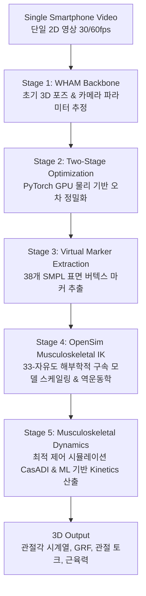

# 📄 [논문 리뷰] OpenCap Monocular: 3D Human Kinematics and Musculoskeletal Dynamics from a Single Smartphone Video

> **논문 정보**: Selim Gilon, Emily Y. Miller, Scott D. Uhlrich (University of Utah & Stanford University collaboration)  
> **게재 정보**: arXiv:2603.24733v1 [cs.CV], 25 Mar 2026  
> **원문 PDF**: [📄 2603.24733v1_OpenCap_Monocular.pdf](./papers/2603.24733v1_OpenCap_Monocular.pdf)  
> **오픈소스 코드**: [github.com/utahmobl/opencap-monocular](https://github.com/utahmobl/opencap-monocular)  
> **공식 플랫폼**: [opencap.ai](https://opencap.ai)

---

## 📋 Table of Contents
1. [연구 배경 및 문제의식 (Why Monocular OpenCap?)](#1-연구-배경-및-문제의식-why-monocular-opencap)
2. [핵심 알고리즘 파이프라인 (5-Stage Architecture)](#2-핵심-알고리즘-파이프라인-5-stage-architecture)
3. [물리 기반 2단계 최적화 손실 함수 (Biomechanical Optimization Losses)](#3-물리-기반-2단계-최적화-손실-함수-biomechanical-optimization-losses)
4. [정량적 검증 결과 (Validation vs Gold Standard)](#4-정량적-검증-결과-validation-vs-gold-standard)
5. [스포츠 바이오메카닉스(야구 투구·타격) 적용 시사점](#5-스포츠-바이오메카닉스야구-투구타격-적용-시사점)
6. [내일(6회차) 3D 야구 실습 연계 체크포인트](#6-내일6회차-3d-야구-실습-연계-체크포인트)

---

## 1. 연구 배경 및 문제의식 (Why Monocular OpenCap?)

### 1.1 전통적 3D 모션 캡처의 한계
- 고정밀 생체역학 분석의 표준(Gold Standard)은 마커 기반 적외선 카메라 시스템(Vicon, Qualisys)과 지면반력기(Force Plate)임.
- 그러나 **1억 5천만 원(>$150,000)을 상회하는 막대한 도입 비용**, 전용 암실 연구실 필요, 30~50개 마커 부착 및 사후 수작업 갭필링(Gap-filling) 등으로 인해 대부분의 선행 연구가 피험자 10~20명 수준의 소규모에 그침.

### 1.2 1세대 Multi-Camera OpenCap (2023)
- 스탠포드대 Scott Uhlrich 박사 연구팀이 *Nature Communications* (2023)에 발표한 1세대 OpenCap은 **2대 이상의 스마트폰(iOS)**과 클라우드 연산을 결합하여 모션 캡처 비용을 $1,000 이하, 측정 시간을 10분 내외로 단축.
- 발표 후 3년간 전 세계 **14,000명의 연구자가 400,000건 이상의 모션 트라이얼**을 수집하며 임상 및 스포츠 현장의 대규모 3D 분석을 촉발함.

### 1.3 2세대 OpenCap Monocular (2026.03 최신 연구)
- 2대의 스마트폰과 삼각대 2개, 캘리브레이션 체커보드, 노트북을 현장에 지참해야 하는 번거로움마저 제거.
- **"주머니 속 스마트폰 단 1대(Single Static Smartphone Video)로 3차원 골격 운동학(Kinematics)뿐만 아니라 지면반력(GRF)·관절 모멘트·근육 힘 등 운동역학(Kinetics)까지 동시에 복원"**하는 혁신적 파이프라인 개발.

---

## 2. 핵심 알고리즘 파이프라인 (5-Stage Architecture)

1. **Stage 1: Monocular 3D Human Pose Estimation (WHAM)**
   - 최신 컴퓨터 비전 기반 모노큘러 포즈 추정 모델인 **WHAM (World-grounded Humans in Action Model)**을 활용하여 2D 비디오로부터 글로벌 좌표계 기준 초기 3D 인간 메시(SMPL) 궤적을 획득.
2. **Stage 2: Two-Stage Biomechanical Pose Refinement Optimization**
   - 단순 비전 모델의 치명적 결함(발 미끄러짐, 깊이 축 드리프트)을 해결하기 위해 PyTorch 기반 GPU 역전파 최적화 수행.
   - **Video-LLaMA3** 파운데이션 모델을 파이프라인 전면에 배치하여 동작(보행, 스쿼트, 앉았다 일어서기, 스포츠 등)을 자동 분류하고 손실 함수 가중치를 동적으로 할당.
3. **Stage 3: Virtual Surface Marker Extraction**
   - 최적화된 SMPL 체표면 버텍스에서 **38개의 가상 마커(Virtual Markers)** 궤적을 생성.
4. **Stage 4: Biomechanically Constrained Musculoskeletal Modeling (OpenSim)**
   - SMPL과 달리 물리적·해부학적으로 불가능한 관절 꺾임을 배제하기 위해, **33 자유도(DOF)를 갖는 OpenSim 인체 근골격 모델**을 적용.
   - 피험자 신장 및 정적 자세에 맞추어 모델 분절을 스케일링(Scale Tool)한 후 역운동학(Inverse Kinematics, IK)을 풀어 최종 3D 관절각 도출.
5. **Stage 5: Kinetics Estimation (Physics Simulation + Machine Learning)**
   - **지면반력계(Force Plate) 없이** 발바닥 당 6개의 Hunt-Crossley 접촉 구체 모델을 배치하고, CasADI 직접 배치(Direct Collocation) 최적 제어를 통해 수직/전후 지면반력(GRF), 하지 관절 모멘트, 주동근 근육 힘을 산출.

---

## 3. 물리 기반 2단계 최적화 손실 함수 (Biomechanical Optimization Losses)

컴퓨터 비전 포즈 추정 모델을 바이오메카닉스 실무에 그대로 쓰지 못하는 가장 큰 이유는 **'발이 바닥을 미끄러지는 현상(Foot Skating)'**과 **'시간 경과에 따른 깊이 방향 위치 발산(Translational Drift)'** 때문임. 본 논문은 2단계 최적화 함수로 이를 완벽히 해결함:

$$J_{\text{stage2}} = w_r L_{\text{repr}} + w_c L_{\text{cam}} + w_v L_{\text{foot vel}} + w_s L_{\text{foot slide}} + w_f L_{\text{flat}} + w_{sm} L_{\text{smooth}}$$

| 손실 함수 항 | 물리적 의미 및 알고리즘 역할 |
|:---|:---|
| $L_{\text{repr}}$ | **2D 재투영 오차 (2D Reprojection Loss)**: 추정된 3D 관절을 카메라 파라미터로 재투영했을 때 실제 2D 키포인트와의 차이를 신뢰도($w_i$) 기반으로 가중 최소화 |
| $L_{\text{foot vel}}$ | **발 접촉 속도 제약 (Foot Velocity Loss)**: 발이 지면에 닿아 있는 스탠스 구간 동안 발뒤꿈치/앞꿈치 마커의 속도가 0이 되도록 강제하여 공중 부양 억제 |
| $L_{\text{foot slide}}$ | **발 미끄러짐 방지 (Foot Slide Loss)**: 지속적인 접촉 구간 동안 발의 위치 분산(Variance)을 억제하여 비전 모델 특유의 '빙판 미끄러짐(Skating)' 현상 완전 제거 ⭐ |
| $L_{\text{flat}}$ | **지면 평탄도 제약 (Flat Contact Loss)**: 보행 및 스쿼트 주기 전체에 걸쳐 착지 시 발 마커의 수직 높이($z$)가 일정하게 유지되도록 지면 제약 부여 |
| $L_{\text{smooth}}$ | **속도 평활화 (Velocity Smoothness)**: 관절 선속도의 급격한 튐(Spike)을 억제하여 생체역학적으로 매끄러운 궤적 유도 |

---

## 4. 정량적 검증 결과 (Validation vs Gold Standard)

광학식 마커 모션 캡처(Vicon) 및 지면반력기 실측 데이터셋을 기준으로 OpenCap Monocular의 성능을 검증한 결과:

### 4.1 운동학(Kinematics) 정확도
- **회전 관절각 오차**: 평균 절대 오차(MAE) **4.8°** (단순 비전 모델 CV+IK 대비 **48% 정확도 향상**, $p = 0.036$).
- **골반 병진 이동 오차**: MAE **3.4 cm** (단순 CV+IK 대비 **69% 오차 감소**, $p < 0.001$).
- **위치 드리프트(Drift) 억제 효과**:
  - 의자에서 5회 일어서기 동작 후 단순 CV+IK는 골반 위치가 평균 **56.9 cm**나 허공으로 밀려남.
  - OpenCap Monocular는 물리 최적화를 통해 5회 반복 후에도 드리프트 오차가 **4.9 cm**에 불과 (10배 이상 안정성 입증).

### 4.2 운동역학(Kinetics) 정확도
- **수직 지면반력 (vGRF)**: MAE **9.7% BW** (체중 대비 오차 9.7%).
- 놀랍게도 단 1대의 카메라를 사용했음에도, 수직 지면반력 오차는 **기존 2대 카메라 OpenCap(12.2% ~ 13.5% BW)보다 소폭 더 우수한 결과**를 기록함 (최적화 단계를 통한 질량중심 수직 가속도 추정 정밀화에 기인).
- **임상 지표 검증**: 무릎 골관절염 진행 예측의 핵심인 **무릎 내전 모멘트(KAM)**의 1차 피크 오차가 $0.36\% \text{BW}\cdot\text{ht}$로, 임상 유의 기준인 $0.5\%$ 미만을 달성.

---

## 5. 스포츠 바이오메카닉스(야구 투구·타격) 적용 시사점

본 논문 8페이지의 고찰은 **오늘 수업에서 변경석 박사님이 강조하신 현장 촬영 원칙의 과학적 근거**를 명확히 제시함:

### 5.1 왜 45° 대각선 카메라 배치가 절대적인가?
> *"The frontal and sagittal-only camera views produced visually worse 3D monocular kinematics due to prolonged segment occlusion and a lack of information in an entire plane of movement." (p. 8)*

- 논문 저자들은 정면(0°)과 순수 측면(90°) 카메라 뷰를 테스트한 결과, **특정 평면 전체의 공간 정보가 누락되고 신체 분절의 가림(Occlusion)이 지속되어 3D 관절각 오차가 심각하게 악화됨**을 입증함.
- **45° 전측면(Anterolateral View)** 각도만이 단일 카메라로도 시상면(Sagittal)과 전두면(Frontal)의 운동을 동시에 복원할 수 있는 유일한 기하학적 앵글임.

### 5.2 야구 투구 및 타격 동작 분석 시 핵심 이점
1. **앞발 착지(Stride Foot Contact) 시 지면반력 브레이킹**:
   - $L_{\text{foot slide}}$ 손실 함수 덕분에 투수나 타자가 디딤발을 내딛는 순간 바닥에서 미끄러지지 않고 견고하게 락킹(Foot Plant)되는 키네틱 체인의 시작점을 정확히 포착 가능.
2. **골반-상체 분리각 (X-Factor) 3차원 회전 복원**:
   - 2D 영상(4회차 실습)에서는 측면 1대로 어깨 외회전(MER)이나 몸통 꼬임을 측정할 수 없었으나, 33-자유도 OpenSim 인체 모델을 통해 흉곽과 골반의 상대적 3차원 축회전을 안정적으로 계산.
3. **단일 카메라 vs 2대 카메라 OpenCap의 선택**:
   - 고속 회전과 강한 팔꿈치 굴곡이 동반되는 야구 투구의 경우, 깊이(Depth) 정보를 물리적 시차(Disparity)로 직접 계산하는 **2대 스테레오 OpenCap(내일 실습할 방식)**이 고속 모션 추적에서 여전히 가장 안전하고 검증된 선택지임.

---

## 6. 내일(6회차) 3D 야구 실습 연계 체크포인트

우리 조는 내일 6회차 실습 동작으로 **야구 투구 및 타격 동작**을 집중 분석하기로 결정함.

- **실습 프로세스**:
  1. **1부**: OpenCap 웹 인터페이스(`opencap.ai`) 연동 및 아이폰 2대 듀얼 세팅 매뉴얼 숙지.
  2. **2부**: 야구 투구/타격 동작 데이터 수집 $\rightarrow$ 클라우드 3D 렌더링 $\rightarrow$ 관절각 시계열 데이터 추출.
- **주요 관찰 변인 (2~3개)**:
  - 투구 시 **앞무릎 착지 각도 및 신전 타이밍** (하체 브레이킹)
  - **골반-몸통 분리각 (Pelvis-Thorax Separation, X-Factor)**
  - 볼 릴리스 직전 **어깨 최대 외회전(MER, Maximum External Rotation)** 및 팔꿈치 굴곡각
- **현장 촬영 세팅**:
  - 두 대의 아이폰을 **투구 방향 정면 기준 30° ~ 45° 대각선**에 거치.
  - 전신 프레이밍 유지 및 투구 전 3초간 기본 해부학적 정적 트라이얼(Static Trial) 필수 수행.