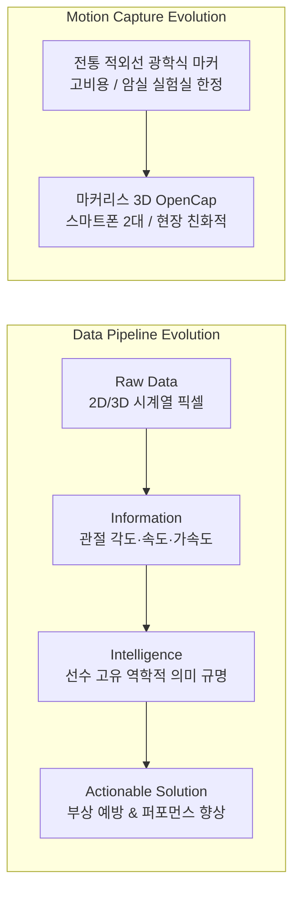
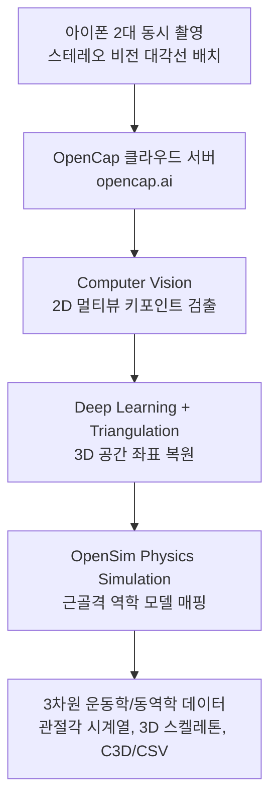

# 🏃‍♂️ 5회차: 스포츠영상분석 자료수집 및 가공 (3차원) (3D Data Collection & Processing)

> **교육 일시**: 2026년 10월 24일 (토) 10:00 ~ 17:00 (총 7시간)  
> **강사**: 변경석 박사 (체육학 Ph.D / 現 벡터바이오 대표, KBO 두산 베어스·SSG 랜더스·삼성 라이온즈 바이오메카닉스 전담)  
> **장소**: 서울 송파구 올림픽공원 내 스포츠인재아카데미 2강의실  
> **정리자**: 이준형 (Junhyeong Lee)  
> **교육 주제**: 3D 마커리스 모션 캡처(OpenCap) 아키텍처, 생체역학 데이터의 가치 평가, 빅데이터 & AI 예측 모델링  
> **핵심 도구**: OpenCap (스탠포드대 3D Markerless Pose Estimation), OpenSim 근골격 시뮬레이션, iOS 듀얼 스테레오 비전  
> **실습 예고**: 익일(10/25 일, 6회차) 아이폰 2대 기반 OpenCap 현장 데이터 수집 및 3D 동작분석 조별 결과지 작성 실습

---

## 📋 Table of Contents
1. [오늘의 강의 개요 및 핵심 아젠다](#1-오늘의-강의-개요-및-핵심-아젠다)
2. [세션 1: 데이터 생태계 패러다임 변화 — 뼈대 추출에서 '의미 도출'로](#2-세션-1-데이터-생태계-패러다임-변화--뼈대-추출에서-의미-도출로)
3. [세션 2: 생체역학 데이터의 가치 사슬 (Data → Information → Intelligence)](#3-세션-2-생체역학-데이터의-가치-사슬-data--information--intelligence)
4. [세션 3: 생체역학 변인의 표준화(Normative Data) 경계](#4-세션-3-생체역학-변인의-표준화normative-data-경계)
5. [세션 4: 스포츠 현장 협업 윤리와 바이오메카니스트의 커리어](#5-세션-4-스포츠-현장-협업-윤리와-바이오메카니스트의-커리어)
6. [세션 5: 3D 마커리스 모션 캡처 기술: OpenCap 심층 분석](#6-세션-5-3d-마커리스-모션-캡처-기술-opencap-심층-분석)
7. [세션 6: OpenCap 현장 촬영 프로토콜 및 실무 촬영 원칙](#7-세션-6-opencap-현장-촬영-프로토콜-및-실무-촬영-원칙)
8. [오늘의 정리 및 차회(6회차 - 3D 조별 실습) 일정 안내](#8-오늘의-정리-및-차회6회차---3d-조별-실습-일정-안내)

---

## 1. 오늘의 강의 개요 및 핵심 아젠다



- **핵심 아젠다**:
  1. **데이터 해석의 고도화**: 단순 영상 내 관절 좌표 추출이나 1차원적 각도 계산을 넘어, 수집된 생체역학 데이터가 **개별 선수에게 어떤 물리적·기능적 의미를 갖는가**를 정의하는 분석관의 통찰력 정립.
  2. **빅데이터 & AI 예측 모델링**: 생체역학 환경에서의 빅데이터 기준(약 500명 규모)과 단순 사후 기술 통계를 넘어선 **부상 위험도 및 구속 예측 모델**로의 진화.
  3. **3D 마커리스 혁신 (OpenCap)**: 수억 원 대의 적외선 마커 장비를 대체하여 스마트폰 2대로 현장에서 3차원 근골격 운동학을 복원하는 **OpenCap 아키텍처 및 실전 촬영 원칙** 완벽 체화.

---

## 2. 세션 1: 데이터 생태계 패러다임 변화 — 뼈대 추출에서 '의미 도출'로

### 2.1 관절 뼈대 추출의 범용화
- 과거의 스포츠 영상분석은 영상을 프레임 단위로 수동 디지타이징(Digitizing)하여 랜드마크 좌표를 찍고 각도를 연산하는 것 자체가 고도의 기술적 장벽이었음.
- 그러나 현재는 컴퓨터 비전과 딥러닝 포즈 추정 오픈소스(MediaPipe, YOLO-pose 등)의 발전으로 **관절 각도, 보행 속도, 케이던스를 추출하는 것은 AI 코딩으로 손쉽게 구현 가능한 기초 단계**가 됨.
- 사설 트레이닝 짐, 러닝 앱, 대학 축구부의 단순 GPS 활용(*"오늘 누가 몇 km를 뛰었는가" = 일명 '범인 찾기'식 사후 집계*) 수준에 머무는 분석은 더 이상 현장 경쟁력을 갖지 못함.

### 2.2 스포츠 분석가의 진정한 경쟁력
- 현대 바이오메카닉스의 진정한 가치는 **"추출된 숫자가 이 사람에게 궁극적으로 무슨 의미인가?"**를 해석하는 인텔리전스 단계에 있음.
- **의료/재활 바이오메카닉스 예시**:
  - 파킨슨병 환자 500~1,000명의 3D 보행 패턴 및 질량중심 이동 데이터를 머신러닝 모델에 학습.
  - 일상적인 스마트폰 보행 촬영 영상만으로 정상 보행과 파킨슨 초기 보행을 95% 이상의 신뢰도로 조기 스크리닝.
  - 단순 각도 표시를 넘어 **진단, 처방, 예측 솔루션**을 내놓는 단계까지 도달해야 진정한 스포츠과학 기업 및 분석가로서 독점적 가치를 확보할 수 있음 (현재 국내에서도 이 수준에 도달한 기관은 극소수).

---

## 3. 세션 2: 생체역학 데이터의 가치 사슬 (Data → Information → Intelligence)

```text
[ Data (원천 데이터) ]
  • 손흥민 프리킥 전체 사진 (수백만 픽셀, 관중석, 잔디, 배경 노이즈 포함)
        │
        ▼
[ Information (정제된 정보) ]
  • 디딤발 위치, 킥 순간 족관절 배굴/저굴 각도, 골반 회전 각속도
        │
        ▼
[ Intelligence (역학적 의미 & 인사이트) ]
  • 지면반력 전달 효율, 무릎 외반 토크에 따른 전방십자인대 부하 평가
        │
        ▼
[ Actionable Solution (현장 처방) ]
  • 디딤발 착지 각도 5도 교정 권고, 둔근 안정화 보강 운동 처방
```

### 3.1 사람의 인지 vs AI 연산 처리의 차이
- **인간 전문가**: 맥락(Context)을 이해하므로 손흥민의 킥 동작 중 디딤발과 타격 순간의 분절에 즉각 시각적 초점을 맞추고 배경 노이즈를 필터링함.
- **AI 시스템**: 이미지 전체 픽셀을 균일한 수학적 가중치로 처리하므로 관중석, 날씨, 잔디 상태까지 연산 자원에 포함.
- 데이터의 규모가 기하급수적으로 팽창할 때, 인간의 직관만으로는 다차원 변인 간 상관성을 통제할 수 없으므로 **AI(머신러닝·딥러닝) 기반의 정량적 패턴 탐색**이 필수적이 됨.

### 3.2 생체역학에서의 '빅데이터' 정의
- IT/금융 분야의 수십억 건 빅데이터와 달리, 인체 역학 및 선수 모션 데이터 분야에서는 **약 500명 ~ 1,000명**의 정밀 측정 데이터가 축적되면 유의미한 빅데이터(Big Data)로 규정함.
- **실무적 빅데이터의 정의**: *"단일 분석가의 개인적 인지 역량과 스프레드시트 수작업만으로는 다차원 변인 간의 비선형적 인과관계를 규명할 수 없는 규모의 데이터"*.
- **예측 모델(Predictive Modeling)의 구축**:
  - 사후 분석에 머물지 않고 투수의 키네마틱 시퀀스 데이터만으로 **구속(Velocity) 예측**, 투구 수에 따른 **관절 토크 누적 및 피로도 추정**, 경기 중 **최적 투수 교체 타이밍 제안**까지 확장.
  - 단, 운동역학의 기초 메커니즘을 밝히는 순수 학술 연구는 가설과 변인 통제가 엄격하다면 1~20명의 소수 피험자 분석으로도 충분히 과학적 가치를 가짐.

---

## 4. 세션 3: 생체역학 변인의 표준화(Normative Data) 경계

선수들을 평가할 때 모든 생체역학 지표를 평균치(Normative Data)에 끼워 맞추는 것은 대단히 위험하며, 표준화가 가능한 물리량과 불가능한 물리량을 명확히 분리해야 함.

```text
┌─────────────────────────────────────────────────────────────┐
│                 생체역학 지표의 표준화 기준 체계                │
├──────────────────────────────┬──────────────────────────────┤
│      표준화 가능 (Linear)     │    표준화 위험 (Angular)     │
├──────────────────────────────┼──────────────────────────────┤
│ • 선운동 (Linear Kinematics) │ • 각운동 (Angular Kinematics)│
│ • 신체 중심(COM) 이동 속도   │ • 관절 회전 각도 및 가동 범위 │
│ • 10m/30m 스프린트 시간       │ • 투수 스트라이드 보폭 비율   │
│ • 타구/투구 릴리스 속도      │ • 팔꿈치 굴곡/어깨 외회전 각  │
│ 👉 신체 전체를 단일 질점으로 │ 👉 개인의 해부학적 골격 길이,│
│    취급 가능한 물리 법칙 지표│    근섬유 비율, 유연성 편차 반영│
└──────────────────────────────┴──────────────────────────────┘
```

### 4.1 벡터바이오(VectorBio)의 30개 핵심 역학 변인 도출 사례
- **문제의식**: 투수의 스트라이드를 일률적으로 "신장의 80%가 정답"이라고 규정할 수 없음 (신체 유연성과 고관절 가동성에 따라 60%가 최적인 선수와 85%가 최적인 선수가 나뉨).
- **해결책**:
  - 운동역학 뉴턴 역학 법칙($F=ma$, 운동량 보존 법칙, 키네마틱 시퀀스 에너지 전이)에 입각하여 **역학적으로 타당한 "잘했다/못했다(Good/Bad)"를 객관적으로 평가할 수 있는 핵심 변인 약 30개**를 4년간의 심층 R&D를 통해 선별.
  - 이 검증된 30개 핵심 변인에 대해서만 프로/엘리트 표준 데이터베이스(Normative DB)를 구축.
  - 이후 AI 알고리즘을 결합하여, 모션 캡처 데이터가 입력되면 특정 관절 메커닉 수정 시 구속이 얼마나 변화할지 시뮬레이션하는 솔루션 구현.

---

## 5. 세션 4: 스포츠 현장 협업 윤리와 바이오메카니스트의 커리어

### 5.1 엘리트 선수 메커니즘 개입에 대한 태도
> *"수십 년간 프로 무대에서 살아남은 코칭스태프와 선수의 감각적 경험(80%)은 숫자로 치환할 수 없는 귀중한 자산입니다."*

- **현장 저항(Backlash) 방지**:
  - 데이터 몇 줄, 그래프 몇 개를 들고 엘리트 선수의 고유 폼을 함부로 뜯어고치려(Overhaul) 들면 현장의 극심한 반발을 초래함.
  - 분석가의 본분은 선수를 가르치는 교관이 아니라, **"코치와 선수가 추구하는 기술적 방향성을 객관적·과학적 데이터로 뒷받침해 주는 조력자"**로 포지셔닝하는 것.
- **스킬 코치 vs 바이오메카니스트의 역할 분담**:
  - 스킬 코치는 종목 특유의 감각적 언어(타이밍, 느낌, 구질)로 선수를 지도하고, 바이오메카니스트는 이를 물리량(토크, 각가속도, 지면반력)으로 번역하여 피드백.
  - 서로의 도메인을 깊이 공부하되 고유의 전문성 선을 침범하지 않는 신뢰 구축이 필수.

### 5.2 프로 스포츠 구단의 인력 수요 및 진로
- **Hawk-Eye(호크아이)**를 비롯한 광학식 트래킹 시스템이 KBO 리그 1군 전 구장에 도입되고 미국 메이저리그(Statcast)의 표준이 됨.
- 그러나 고가의 장비에서 매일 테라바이트 단위로 쏟아지는 트래킹 데이터를 운동역학적으로 정제하고, 코칭스태프가 즉시 사용할 수 있는 **'1장짜리 처방 리포트'로 요약해 낼 수 있는 전문 바이오메카니스트는 시장에 극도로 품귀 상태**임 (벡터바이오, 롯데 자이언츠 R&D 박사급 채용 사례 등).

---

## 6. 세션 5: 3D 마커리스 모션 캡처 기술: OpenCap 심층 분석



### 6.1 OpenCap 플랫폼 개요
- **개발**: 미국 스탠포드 대학교(Stanford University) 신경근역학 연구실(Neuromuscular Biomechanics Lab).
- **특징**: 웹 브라우저(`opencap.ai`) 기반 클라우드 연산, 연구/교육용 무료 공개.
- **파이프라인**: 2대의 iOS 기기(아이폰) $\rightarrow$ 2D 영상 클라우드 전송 $\rightarrow$ 컴퓨터 비전(HRNet 등) 2D 관절 검출 $\rightarrow$ 3D 삼각측량 $\rightarrow$ **OpenSim(근골격 역학 모델링) 시뮬레이션 결합**을 통해 물리적으로 불가능한 관절 꺾임이나 노이즈를 근골격 역학 기반으로 보정.
- 클라우드에 축적되는 글로벌 동작 데이터로 인공지능 모델이 지속 재학습(Retraining)됨.

### 6.2 적외선 마커 기반(Qualisys/Vicon) vs 마커리스(OpenCap) 종합 비교

| 비교 항목 | 마커 기반 3D 시스템 (Vicon / Qualisys) | 마커리스 3D 시스템 (OpenCap) |
|:---|:---|:---|
| **측정 원리** | 8~24대 적외선 카메라가 반사 마커의 3D 공간 좌표를 밀리미터 단위 추적 | 2대 이상의 RGB 스마트폰 영상에서 AI가 신체 관절을 확률적으로 추정 |
| **정확도** | **최상 (골드 스탠다드)** — 오차 1mm 이내 | **양호** — AI 추정 오차 존재, 헐렁한 옷 속 실제 뼈 위치 추정 한계 |
| **도입 비용** | **수억 원 대** (전용 카메라, 캘리브레이션 완드, 라이선스) | **수십만 원 대** (기존 보유 아이폰 2대 + 삼각대 2개) |
| **소요 시간** | 마커 부착(30~50개) 20분 + 촬영 + 갭필링(Gap-filling) 수시간 | 별도 부착 없이 촬영 후 **클라우드 자동 처리 10~15분** |
| **환경 제약** | 반사광 및 직사광선 통제된 **암실/실험실 필수** | **야외 경기장, 체육관, 훈련장, 필드 현장** 측정 가능 |
| **주요 용도** | 엘리트 선수의 초정밀 메커닉 검진, 학술 등재지 논문 | 유소년 아카데미, 짐/피트니스, 재활 환자 피드백, 필드 스크리닝 |

> 💡 **현장 실무 하이브리드 적용 팁**:  
> 엘리트 구단 및 연구소에서는 연구실 마커 시스템(Vicon)으로 기준 동작(Ground Truth)을 먼저 계측하고, OpenCap 마커리스 측정 결과와 일치도(ICC/RMSE)를 교차 검증함. 특정 동작에서 유의미한 정확도가 입증되면 경기장 및 원정 훈련 모니터링 시 가벼운 OpenCap을 실전 투입함.

### 6.3 🔬 최신 연구 동향: OpenCap Monocular (2026.03) 논문 심층 리뷰
> 📖 **상세 리뷰 문서**: [📄 OpenCap_Paper_Review.md](./OpenCap_Paper_Review.md)  
> 📑 **원문 논문 PDF**: [📄 2603.24733v1_OpenCap_Monocular.pdf](./papers/2603.24733v1_OpenCap_Monocular.pdf)  
> **논문명**: *OpenCap Monocular: 3D Human Kinematics and Musculoskeletal Dynamics from a Single Smartphone Video* (Gilon, Miller, & Uhlrich, arXiv:2603.24733, 2026.03)

- **핵심 기술 혁신**:
  - 기존 2대 이상 다중 카메라(Multi-camera) 환경을 넘어, **단 1대의 고정 스마트폰 영상(Monocular Video)**만으로 3D 전신 운동학(Kinematics)뿐만 아니라 지면반력(GRF)·관절 모멘트 등 운동역학(Kinetics)까지 엔드투엔드로 복원.
  - **컴퓨터 비전(WHAM) + PyTorch GPU 물리 기반 2단계 최적화 + OpenSim 33-DOF 생체역학 구속 모델**의 유기적 결합.
  - 비전 AI 포즈 모델의 고질적 한계인 **'발 미끄러짐(Foot Skating)' 현상을 $L_{\text{foot slide}}$ 손실 함수로 완전 제거**하여, 5회 반복 동작 시 골반 위치 드리프트(Drift)를 56.9cm에서 **4.9cm**로 10배 이상 격감시킴.
  - 회전 관절각 오차 **4.8° MAE**, 수직 지면반력 오차 **9.7% BW**를 달성하여 마커 기반 시스템 대비 실무적 유효성 입증.
- **현장 촬영 설계의 과학적 근거 (논문 p. 8 검증)**:
  - 논문 연구진은 정면(0°)과 순수 측면(90°) 카메라 각도에서 분절 가림(Occlusion)과 평면 정보 결손으로 인해 3D 복원 품질이 급격히 저하됨을 실험적으로 확인.
  - **"45° 전측면(Anterolateral View) 배치가 3차원 공간 복원에서 시상면과 전두면 정보를 동시에 보존하는 유일한 수학적 최적해"**임을 입증하여, 오늘 강의에서 변경석 박사님이 강조하신 30°~45° 대각선 촬영 원칙의 이론적 기반을 확증함.

---

## 7. 세션 6: OpenCap 현장 촬영 프로토콜 및 실무 촬영 원칙

내일(10/25) 3D 실습 및 실제 현장 측정 시 반드시 준수해야 하는 **6대 촬영 원칙**:

### 7.1 전신 프레이밍 (Full-Body Framing) 필수
- OpenCap의 딥러닝 포즈 모델은 머리 끝부터 발끝까지 전신이 온전히 나오는 이미지로 학습됨.
- 신체 분절 중 발끝이나 손끝이 프레임 밖으로 단 1프레임이라도 잘리면 전체 3D 스켈레톤의 스케일과 관절 좌표가 심각하게 왜곡됨.
- 전신을 잡기 어려운 넓은 동선의 경우, **가장 핵심적인 퍼포먼스 국면(임팩트, 릴리스, 최저점 등)**에서 전신이 완벽히 담기도록 화각을 설계해야 함.

### 7.2 카메라 배치: 정면 기준 30° ~ 45° 대각선 배치의 법칙
- ⚠️ **생체역학적 직관에 반하는 핵심 원칙**:
  - 스쿼트, 보행, 러닝 등 전형적인 **시상면(Sagittal Plane) 굴곡/신전 동작**을 분석할 때, 2D 분석의 관성으로 카메라를 90° 순수 측면에 배치하는 실수를 범하기 쉬움.
  - 마커리스 3D는 두 카메라 영상의 시차(Disparity)를 이용해 깊이(Depth)를 계산하므로, 90° 측면에서 촬영하면 **반대편 팔다리가 몸통에 가려져(Occlusion)** 3D 복원 알고리즘이 심각한 좌표 떨림(Jitter)과 오차를 발생시킴.
  - 👉 **해결책**: 두 대의 카메라를 대상자의 **정면 기준 좌우 30° ~ 45° 대각선**에 거치하여, 동작 중 양쪽 팔다리가 두 카메라 모두에 상시 노출되도록 배치해야 최상의 3D 관절 궤적이 산출됨.

```text
               [피험자 동작 영역]
                    ▲
                   / \
                  /   \  (30° ~ 45° 대각선 화각)
                 /     \
                /       \
      [카메라 1 (좌측)]   [카메라 2 (우측)]
          (iPhone A)         (iPhone B)
```

### 7.3 진행 방향 동선 설계
- 달리기나 보행을 분석할 때 카메라 옆을 가로질러 지나가게(Side-pass) 설계하면 깊이 추정 오차가 극대화됨.
- 반드시 **카메라를 정면으로 바라보며 다가오는(Coming toward the cameras)** 동선으로 주로를 배치해야 함.

### 7.4 정적 트라이얼 (Static Calibration Trial) 선행
- 동적 동작을 수행하기 직전, 카메라 앞에서 **기본 해부학적 중립 자세(Neutral Standing Pose)**로 약 2~3초간 미동 없이 정지한 정적 트라이얼을 먼저 촬영해야 함.
- 이 정적 데이터를 통해 OpenSim 모델의 분절 길이(대퇴골, 경골, 상완골 등)를 피험자의 실제 체격에 맞춰 1:1 맞춤 스케일링함.

### 7.5 단일 피험자 통제 (Background Occlusion 차단)
- OpenCap AI는 다수의 인물이 화면에 잡힐 경우 카메라와 더 가까운 사람으로 트래킹 타깃을 제멋대로 전환함.
- 측정 중에는 분석 대상자 1인 외에 다른 인물이 카메라 화각 내로 진입하거나 배경을 지나가지 않도록 통제 필수.

### 7.6 체커보드(Checkerboard) 공간 캘리브레이션
- 두 카메라의 상대적 위치(Extrinsics)와 렌즈 왜곡(Intrinsics)을 정렬하기 위해, 바닥에 인쇄된 표준 체커보드를 비추어 글로벌 좌표계의 원점($[0,0,0]$)과 축($X, Y, Z$)을 정의함.

---

## 8. 오늘의 정리 및 차회(6회차 - 3D 조별 실습) 일정 안내

### 8.1 5회차 핵심 요약 체크리스트
- [x] 단순 뼈대 추출 단계를 넘어선 생체역학 데이터의 인텔리전스 가치 체화
- [x] 표준화 가능한 선운동 지표 vs 개인화가 필수적인 각운동 메커닉 지표의 구분 기준 확립
- [x] 벡터바이오 기반 뉴턴 역학 30개 핵심 표준화 변인 도출 원리 이해
- [x] 스탠포드 OpenCap 3D 마커리스 아키텍처 및 OpenSim 물리 시뮬레이션 연동 원리 학습
- [x] OpenCap 실전 6대 촬영 원칙 (전신 화각, 30°~45° 대각선 배치의 역학적 이유, 정적 트라이얼 등) 체득

### 8.2 차회 강의 (6회차 - 2026. 10. 25. 일요일 10:00~17:00) 예고
- **교육 주제**: **스포츠영상분석 결과지 작성 (3차원) — OpenCap 실전 3D 모션 캡처 및 결과지 작성**
- **우리 조(3조) 확정 분석 동작**: ⚾ **야구 투구 및 타격 동작 (Baseball Pitching & Batting) 3D 생체역학 분석**
- **준비물**: 조별 아이폰 2대, 대형 삼각대 2개, 스마트폰 마운트, OpenCap 계정, 분석용 노트북, 야구 글러브/배트
- **수업 진행 구성 (2개 파트)**:
  1. **1부: OpenCap 사용 설명 및 시스템 매뉴얼 교육**
     - `opencap.ai` 웹 플랫폼 계정 연동 및 클라우드 파이프라인 이해
     - 체커보드(Checkerboard) 캘리브레이션 및 아이폰 2대 듀얼 스테레오 비전 세팅
     - 기본 해부학적 중립 자세(Static Calibration Trial) 표준 프로토콜 숙지
  2. **2부: 현장 야구 데이터 수집 및 3D 모션 캡처 실습**
     - 투구 방향 정면 기준 30°~45° 대각선 카메라 배치 및 전신 화각 확보
     - 조원별 야구 투구/타격 동작 수집 $\rightarrow$ OpenCap 클라우드 자동 3D 렌더링
     - 핵심 운동학 변인 2~3개 정량화:
       * **앞발 착지(Foot Strike) 시 무릎 각도 및 하체 브레이킹 메커니즘**
       * **골반-몸통 분리각 (Pelvis-Thorax Separation, X-Factor 회전 타이밍)**
       * **볼 릴리스 직전 어깨 최대 외회전(MER) 및 팔꿈치 굴곡 각도**
     - 3D 모션 시각화 및 **1~2페이지 정밀 3D 스포츠 분석 결과지** 리포트 작성 & 조별 성과 발표

---
> 📌 *참고: 본 마크다운 문서는 5회차 강의 녹취록 및 바탕화면의 [`2026-10-24_lecture-notes.md`](./2026-10-24_lecture-notes.md) 요약본을 토대로 체계화되었습니다.*