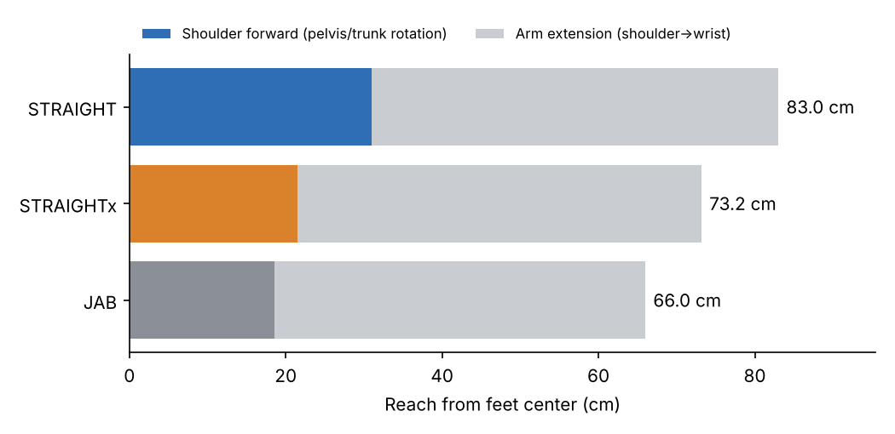
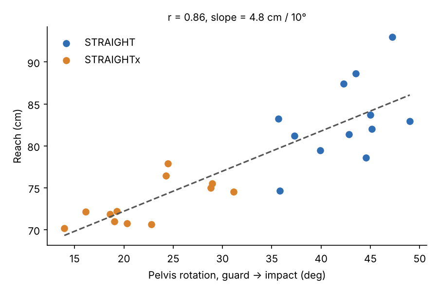
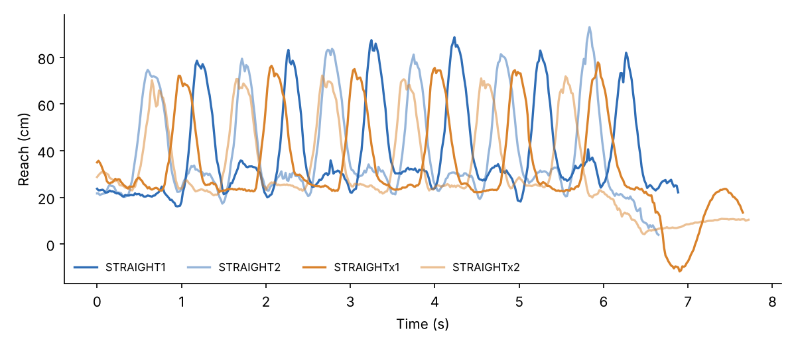
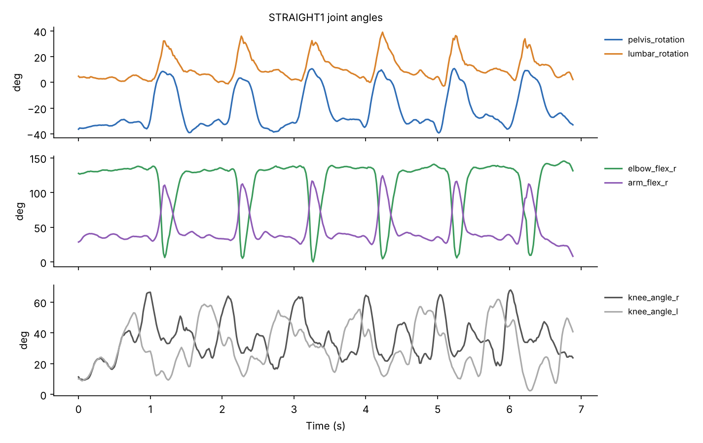

# 7회차: 스포츠영상 분석 적용 실습 (Part 1)

- **일자**: 2026. 10. 31. (토)
- **시간**: 10:00 ~ 17:00

## 🎯 학습 목표
- 종목별 실제 경기 및 훈련 영상 대상 엔드투엔드(End-to-End) 분석 파이프라인 구축
- 실전 데이터 추출 및 오류 보정 실습

## 📝 수업 노트 & 실습

### 수업 내용 요약
- **오전 (이론 + 시연)**: 포즈 추정 데이터 품질 조건(빛, 타이트한 옷, 대비색), 체커보드 배치(수직, 넓은 쪽 아래, 3m 이상), OpenCap 과정(캘리브레이션 → 뉴트럴 → 트라이얼), 필터링과 신호 처리의 필요성
- **오후 (분석 방법)**: 동작 정량화를 위한 **이벤트 정의**(보행 접지·이지, 스쿼트 시작·최저점·복귀), 정지 구간 평균±2SD **역치**로 시작 시점 찾기, 여러 데이터에 한 번에 적용할 수 있는 **파이프라인**의 중요성, OpenCap 로우 데이터(.trc/.mot) 구조
- **조별 실습**: 야외에서 OpenCap으로 복싱 기본기(스텝, 잽, 스트레이트 등) 14개 트라이얼 측정

자세한 내용은 [강의 정리](notes/2026-10-31_lecture-notes.md)와 [측정 과정 및 시행착오](notes/opencap-session-log.md)를 참고하세요.

---

## 🥊 실습: OpenCap 복싱 동작 분석

스마트폰 2대와 [OpenCap](https://www.opencap.ai/)으로 복싱 동작을 3D로 측정하고, **하체·골반 회전이 스트레이트 리치에 얼마나 기여하는지** 분석했습니다.

### 핵심 결과

같은 피험자가 스트레이트를 두 조건으로 6회씩, 2세트 쳤습니다.
- **STRAIGHT**: 스텝과 하체 회전을 사용
- **STRAIGHTx**: 하체 고정

| | STRAIGHT | STRAIGHTx | 차이 |
|---|---|---|---|
| 평균 리치 | 83.0 cm (키의 53.6%) | 73.2 cm (47.2%) | **+9.8 cm** (p < 0.001) |
| 어깨 전진 (발→어깨) | 31.0 cm | 21.5 cm | +9.5 cm |
| 팔 뻗음 (어깨→손목) | 52.0 cm | 51.7 cm | ≈ 0 |
| 골반 회전 (가드→타격) | 42.3° | 22.3° | +20.0° |

- 팔이 뻗는 길이는 두 조건이 같습니다. **리치 차이는 거의 전부 골반·몸통 회전이 어깨를 앞으로 밀어준 데서 나옵니다.**
- 골반 회전량과 리치는 강한 상관을 보였습니다 (r = 0.86). 회전 10°당 리치가 약 4.8 cm 늘었습니다.





STRAIGHT1의 관절 각도입니다. 펀치마다 골반 회전 → 허리 회전 → 팔꿈치 신전 순서로 움직입니다.



### 왜 속도가 아니라 리치인가

스마트폰 영상(60fps)과 OpenCap 필터링 특성상, 펀치처럼 빠른 동작의 최고 속도는 낮게, 들쭉날쭉하게 추정되기 쉽습니다. 반면 **최대로 뻗은 위치는 안정적으로 잡힙니다.** 사람 간 비교를 할 때는 키로 나눈 값(%H)을 쓸 수 있습니다.

### 측정 방법

- **리치**: 펀치를 다 뻗은 순간, 그 순간의 양 발목 중간점에서 손목까지의 수평 거리를 펀치 방향으로 투영한 값
  - 리치 = (발 → 어깨) + (어깨 → 손목)
  - 스트레이트는 오른손, 잽은 왼손 기준
- **펀치 검출**: 발→손목 거리 신호의 봉우리 (`scipy.signal.find_peaks`, prominence 15 cm)
- **이벤트**: 각 펀치의 *가드*(직전 리치 최소)와 *타격*(리치 최대) 시점
- **회전량**: 가드 → 타격 사이 `pelvis_rotation` 변화. 몸통은 `pelvis_rotation + lumbar_rotation`

### 한계

- 피험자 1명, 조건별 12회
- STRAIGHTx도 골반이 약 22° 돌아가 하체가 완전히 고정되지는 않았습니다. 하체의 실제 기여도는 이 결과보다 클 수 있습니다.
- STRAIGHT는 타격 때 발 중심이 평균 4 cm 뒤로 이동합니다. 가드 때 발 위치를 기준으로 재면 리치 차이는 5.4 cm입니다 (`ground_reach_cm`).
- OpenCap 기본 필터만 적용했고, 추가 필터링은 하지 않았습니다.

### 폴더 구조

```
├── analysis/
│   ├── reach_analysis.py       # 분석 코드 (실행하면 results/ 생성)
│   └── requirements.txt
├── data/opencap/               # OpenCap 다운로드 데이터 (영상 제외)
│   ├── MarkerData/*.trc        # 3D 마커 좌표 (60Hz, m, Y축이 위쪽)
│   ├── OpenSimData/
│   │   ├── Kinematics/*.mot    # 관절 각도 (deg)
│   │   └── Model/*.osim        # 피험자에 맞춰 스케일링한 근골격 모델
│   └── sessionMetadata.yaml    # 세션 설정 (익명화)
├── results/
│   ├── punches.csv             # 펀치별 측정값
│   ├── summary.csv             # 동작별 평균
│   └── figures/
└── notes/
    ├── 2026-10-31_lecture-notes.md   # 강의 정리
    └── opencap-session-log.md        # 측정 과정과 시행착오
```

### 실행 방법

```bash
pip install -r analysis/requirements.txt
python analysis/reach_analysis.py
```

### 데이터 관련 안내

- 원본 영상(`Videos/`, 약 300 MB)과 캘리브레이션 이미지는 **피험자 얼굴이 나오고 용량이 커서 포함하지 않았습니다.**
- 피험자 ID는 `S01`로 익명화했고, 기기 ID는 삭제했습니다.
- `.trc`, `.mot`는 텍스트 파일이라 엑셀로도 열 수 있습니다. `.mot`는 OpenSim GUI에서 `.osim` 모델과 함께 불러오면 애니메이션으로 볼 수 있습니다.

### 참고

- Uhlrich, S. D. et al. (2023). OpenCap: Human movement dynamics from smartphone videos. *PLOS Computational Biology*.
- OpenCap: https://www.opencap.ai/
