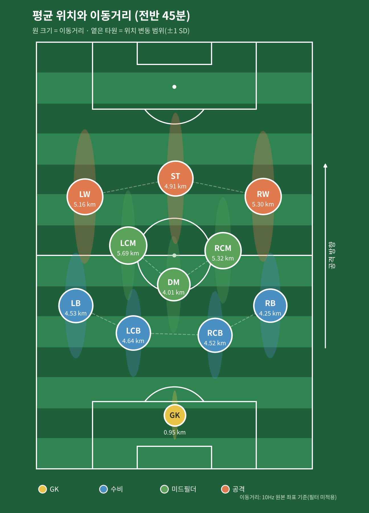
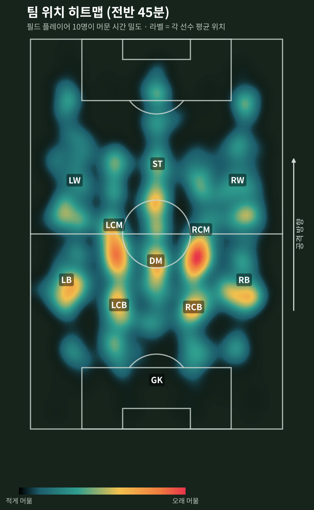
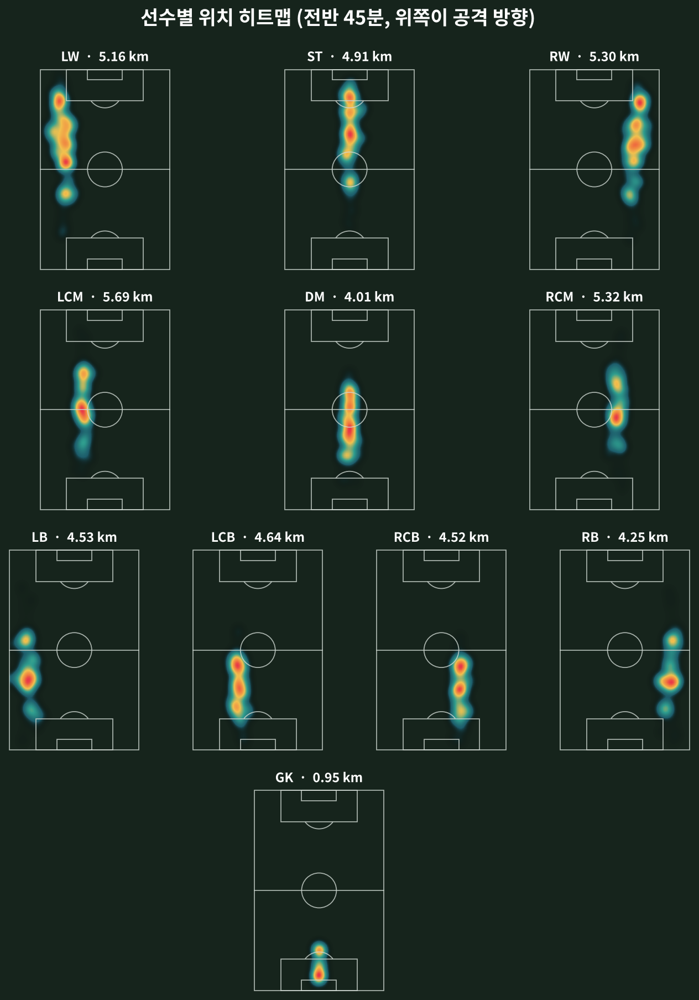

# 8회차: 스포츠영상 분석 적용 실습 (Part 2)

- **일자**: 2026. 11. 01. (일)

## 📝 수업 노트 & 실습

### 수업 내용 요약
- **오전 (엑셀 실습)**: 축구 트래킹 데이터(11명, 10Hz, 45분)로 포지션별 속도·이동거리를 엑셀 함수로 계산하고 요약표와 그래프 작성
- **오후 (바이오메카닉스 현장 적용)**: 측정 → 산출 → 분석 → **해석**의 차이, 정량 데이터의 신뢰도와 타당도(서전트 점프 h = g·t²/8의 함정), 마커 기반 vs 마커리스 비교, 야구 투구 구간별 핵심 변인(힙 드라이브, 지면반력 벡터, 스트라이드, 견갑 장전, 키네마틱 시퀀스), "같은 결과, 다른 해석" 사례
- **핵심 메시지**: 데이터를 뽑는 것보다 **현장이 활용하도록 설득하는 소통 능력**이 가장 중요하다
- **질의응답**: 현장에서 느끼는 컴퓨터 비전(마커리스)의 한계

자세한 내용은 [강의 정리](notes/2026-11-01_lecture-notes.md)와 [엑셀 실습 노트](notes/excel-speed-distance.md)를 참고하세요.

---

## ⚽ 실습: 축구 트래킹 데이터 분석

### 데이터
| 항목 | 내용 |
|---|---|
| 선수 | 한 팀 11명 (4-3-3) |
| 값 | 선수별 x, y 좌표 (m). x는 폭 방향 0~68m, y는 길이 방향 0~105m (클수록 상대 골대 쪽) |
| 샘플링 | 10Hz (0.1초), 27,000프레임 = 45분 |

### 포지션별 요약

| Position | 평균 속도 (km/h) | 최고 속도 (km/h) | 이동거리 (km) |
|---|---|---|---|
| GK | 1.27 | 8.79 | 0.95 |
| RB | 5.67 | 28.76 | 4.25 |
| RCB | 6.03 | 27.62 | 4.52 |
| LCB | 6.19 | 28.00 | 4.64 |
| LB | 6.04 | 30.95 | 4.53 |
| DM | 5.35 | 26.14 | 4.01 |
| RCM | 7.09 | 35.55 | 5.32 |
| LCM | 7.58 | 37.24 | 5.69 |
| RW | 7.07 | 38.79 | 5.30 |
| ST | 6.55 | 36.67 | 4.91 |
| LW | 6.89 | 34.92 | 5.16 |

- 중앙 미드필더(LCM, RCM)와 윙어가 가장 많이 뛰었고, DM은 위치를 지키는 역할답게 미드필더 중 가장 적었다.
- 최고 속도 35~39km/h는 실제보다 높다. 10Hz 원본 좌표의 작은 떨림(노이즈)이 속도로 잡힌 결과로, 필터링이 필요하다.

### 시각화

| 평균 위치와 이동거리 | 팀 위치 히트맵 |
|---|---|
|  |  |



- 평균 위치만으로도 4-3-3 포메이션이 그대로 드러난다.
- 선수들은 자기 레인을 거의 벗어나지 않고 **앞뒤(세로)로 크게** 움직였다. 공격과 수비 전환 때 팀 전체가 함께 오르내린 것으로 보인다.

### 폴더 구조
```
├── analysis/soccer_analysis.py   # 요약표와 그림 3장을 만드는 코드
├── data/                         # soccer_rawdata.xlsx를 넣는 곳
├── results/
│   ├── position_summary.csv
│   └── figures/
└── notes/
    ├── 2026-11-01_lecture-notes.md
    └── excel-speed-distance.md
```

### 실행 방법
```bash
pip install pandas numpy scipy matplotlib openpyxl
python analysis/soccer_analysis.py
```
