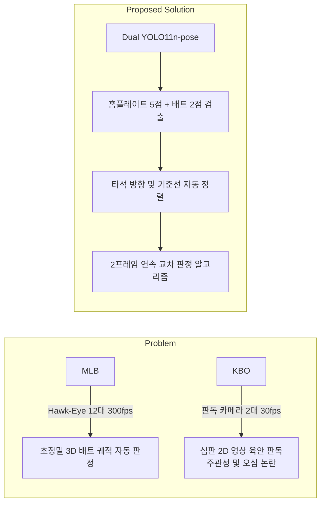
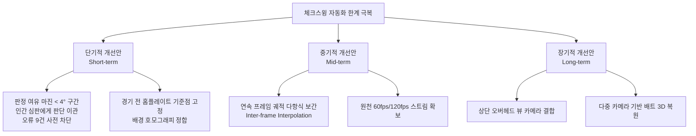

# 🎓 9회차: 최종 성과물 발표 및 수료 (Final Project Presentation)

> **일시**: 2026년 11월 7일 (토) 10:00 ~ 17:00 (총 7시간)  
> **장소**: 서울 송파구 올림픽공원 내 스포츠인재아카데미 2강의실  
> **발표자**: 이준형 (Junhyeong Lee)  
> **심사 및 강사진**: 변경석 박사 (벡터바이오 대표), 이효근 교수 (광운대학교 스포츠융합과학과)  
> **프로젝트 주제**: **KBO 체크스윙 실시간 자동 판정 시스템 — 좌표 데이터로 다시 본 오판정 19건의 원인과 마커리스 컴퓨터 비전의 한계**  
> **기반 학술 논문**: 한국멀티미디어학회논문지 Vol.29 No.7 (2026.7), [doi.org/10.9717/kmms.2026.29.7.1026](https://doi.org/10.9717/kmms.2026.29.7.1026)

---

## 📌 발표 자료 및 관련 아카이브

- 📑 **발표 슬라이드 (PDF)**: [스포에듀_성과물발표.pdf](./스포에듀_성과물발표.pdf) *(총 12장 슬라이드)*
- 📝 **발표 회고 및 피드백 상세 노트**: [성과물_발표_회고_체크스윙_자동_판정_한계_분석.md](./성과물_발표_회고_체크스윙_자동_판정_한계_분석.md)
  - *슬라이드별 발표 내용, 질의응답 및 강사 피드백 전문, 발표 중 정정 사항, 향후 연구 과제 수록*
- 📜 **과정 공식 수료증 (PDF)**: [스포츠영상분석_교육수료증.pdf](../docs/스포츠영상분석_교육수료증.pdf) *(국민체육진흥공단 KSPO 발행, 제2026-00512578호)*

---

## 🎯 프로젝트 개요 및 연구 배경



- **문제의식**:
  - 미국 메이저리그(MLB)는 12대의 초고속 호크아이(Hawk-Eye) 카메라와 300fps 3D 광학 추적을 통해 체크스윙을 판정하는 반면, KBO 리그는 2대의 2D 중계/판독 카메라에 의존하여 심판이 모니터를 보고 주관적으로 판정함.
  - 야구 규칙상 체크스윙은 "타자가 스윙하려는 의도가 있었는가"라는 주관적 정의에서 출발했으나, 기술의 발전에 따라 **"배트 헤드가 홈플레이트 전면과 평행한 기준선을 넘었는가(각도/변위)"**라는 기하학적 기준으로 정량화되고 있음.
- **연구 내용**:
  - 단일 2D 측면 영상에서 초경량 포즈 추정 모델(Dual YOLO11n-pose)을 활용하여 홈플레이트 5개 기준점과 배트 손잡이·노브 2개 키포인트를 실시간 검출.
  - 홈플레이트 기하 구조 기반 기준선 및 타석 방향 벡터를 도출하고, 4단계 판정 알고리즘(유효 상태 $\rightarrow$ 기준선 $\rightarrow$ 선 교차 $\rightarrow$ **2프레임 연속 교차 확정 규칙**)을 구축.
- **기존 성능**:
  - KBORC 비디오 판독 영상 145건 대상 **정확도 83.45%**, **정밀도 93.42%**, **재현율 78.89%**, **F1-score 85.54%** 달성.
  - 그러나 실제 스윙 90건 중 **19건을 노스윙으로 오판정(False Negative)**하는 한계 발생.

---

## 🔬 16,723 프레임 좌표 데이터 심층 분석: 오판정 19건의 근본 원인

발표에서는 기존 논문의 거시적 평가를 넘어, **총 16,723개 프레임의 관절/키포인트 원천 좌표 시계열 데이터를 전수 분석**하여 145건 전 케이스를 재현하고 19건의 오판정 원인을 역학적·기하학적으로 규명했습니다.

```text
┌─────────────────────────────────────────────────────────────────────────┐
│               체크스윙 오판정 19건 원인 분석: 가설 검증 결과                │
├───────────────────────────────────┬─────────────────────────────────────┤
│        기각된 가설 (원인 아님)       │        확인된 근본 원인 (True Causes) │
├───────────────────────────────────┼─────────────────────────────────────┤
│ ❌ 배트 검출 실패 (145/145 탐지 성공) │ ⚠️ 홈플레이트 기저선의 기하학적 레버리지 │
│ ❌ 고속 스윙 시 모션 블러 영향        │    (앞면 길이가 짧아 1px 오차 ≈ 2° 회전) │
│ ❌ 중앙값 스무딩 필터 왜곡         │ ⚠️ 백스탑 그물망(Mesh)에 의한 키포인트 요동│
│                                   │ ⚠️ 마커리스 AI의 과신(Confidence 0.95)   │
└───────────────────────────────────┴─────────────────────────────────────┘
```

1. **홈플레이트 기저선의 기하학적 오차 증폭 (Leverage Effect)**:
   - 홈플레이트 앞면(전면)의 물리적 길이가 짧기 때문에, 비전 모델이 앞면 점 하나를 **단 6픽셀만 잘못 추정해도 기준선 각도가 약 10°(−9.8°) 틀어짐**.
   - 배트 끝이 기준선 근처에 아슬아슬하게 걸치는 경계선 케이스에서 기준선 각도의 미세 왜곡이 스윙/노스윙 판정을 완전히 뒤바꿈.
2. **마커리스 비전 AI의 한계 (수업 핵심 내용과의 직결)**:
   - 움직이지 않는 완전한 정적 구조물(홈플레이트)조차 카메라 진동 및 광학 노이즈로 인해 프레임별로 미세 요동(±2.6°) 발생.
   - 포수 뒤편 그물망(백스탑 메쉬)이 홈플레이트를 가리는 영상에서는 키포인트 진동이 **±7°까지 극대화**.
   - 모델이 좌표를 크게 틀리게 추정하는 순간에도 **신뢰도(Confidence)는 0.95 이상으로 높게 출력**되어 모델 자체 신뢰도만으로는 에러를 필터링할 수 없음.

---

## 👨‍🏫 강사진 핵심 피드백: "공간 오차(px)를 넘어 시간 해상도(fps)의 한계"

발표 직후 벡터바이오 변경석 박사님과 광운대 이효근 교수님의 집중적인 피드백과 질의응답이 진행되었습니다.

### 1. 30fps 촬영의 본질적 한계 (프레임 간 간극)
- **강사 시연**: 3D 타격 분석 도구에서 **300fps로 촬영된 실제 타격 스윙을 60fps/30fps로 다운샘플링**했을 때, 체크스윙 순간(임팩트/브레이킹 존)에 존재하는 데이터 포인트가 불과 1~2개로 급감하는 현상을 시각적으로 입증.
- **시간 축 오차**:
  - 스윙이 가장 빠른 구간에서 배트 끝은 **한 프레임당 약 40픽셀(상위 10%)을 이동**.
  - 시스템이 놓친 스윙 19건은 기준선까지 약 **25픽셀(중앙값) 모자란 상태**였음.
  - 즉, 배트가 기준선을 실제로 통과한 순간이 **"프레임과 프레임 사이(Inter-frame)"**에 존재했을 가능성이 매우 높으며, 30fps 환경에서는 물리적으로 이 순간을 캡처할 수 없음.

### 2. 2프레임 연속 규칙의 트레이드오프
- 키포인트가 1프레임 튀는 이상치(Outlier)를 막기 위해 도입한 '2프레임 연속 교차 규칙'은 노스윙 오판정을 줄여주었지만, 빠른 스윙에서는 1프레임만 교차하고 바로 복귀하는 스윙을 놓치는 원인이 됨.

---

## 🚀 향후 연구 및 시스템 개선 로드맵



1. **신뢰 마진 기반 하이브리드 판정 (즉시 적용)**:
   - 판정 여유 각도가 4° 미만인 모호한 케이스(전체 데이터의 약 8%)는 무리하게 자동 판정하지 않고 **인간 심판(KBORC)에게 판독을 이관하여 전체 오류 24건 중 9건을 사전에 배제**.
2. **홈플레이트 사전 캘리브레이션 (Short-term)**:
   - 매 프레임 홈플레이트를 AI로 추정하지 않고, 경기 시작 전 정적 상태에서 홈플레이트 좌표를 1회 정밀 계측하여 고정한 뒤 카메라 흔들림만 호모그래피(Homography)로 보정.
3. **프레임 간 궤적 보간(Inter-frame Interpolation)**:
   - 연속된 두 프레임의 배트 궤적을 3차 스플라인 또는 등가속도 물리 모델로 보간하여 프레임 사이의 선 교차 시점을 추정.
4. **시점 확장 및 3D 스테레오 비전 (Long-term)**:
   - 측면 단일 뷰의 오클루전 한계를 극복하기 위해 경기장 상단 탑다운(Top-down) 시점 영상 결합 및 스테레오 3차원 배트 궤적 복원 시스템 구축.

---

## 🏆 성과물 발표 요약 및 수료 소회

> *"컴퓨터 비전 AI가 출력하는 숫자를 맹신하지 않고, 공간 해상도(px)와 시간 해상도(fps)의 물리적 한계를 인지하며,  
> '추정(Estimation)'과 '측정(Measurement)' 사이의 간극을 좁히는 것이 스포츠 영상분석 연구자의 진정한 사명이다."*

본 성과물 발표는 9주간 학습한 생체역학 지레 원리, 마커리스 비전의 오차 특성, 광학 카메라 파라미터 및 프레임 레이트 이론을 실제 KBO 리그 비디오 판독 시스템에 투영하여 **스포츠 현장과 인공지능 기술의 접점을 정밀하게 비판·분석한 연구**로 강사진의 높은 평가를 받았습니다.

---

## 📂 9회차 산출물 목록

| 파일명 | 유형 | 설명 |
|:---|:---:|:---|
| [스포에듀_성과물발표.pdf](./스포에듀_성과물발표.pdf) | PDF | 최종 발표 슬라이드 (12장, KBO 체크스윙 한계 분석) |
| [성과물_발표_회고_체크스윙_자동_판정_한계_분석.md](./성과물_발표_회고_체크스윙_자동_판정_한계_분석.md) | Markdown | 발표 녹취 요약, 상세 질의응답 및 자가 회고록 |
| [스포츠영상분석_교육수료증.pdf](../docs/스포츠영상분석_교육수료증.pdf) | PDF | 국민체육진흥공단(KSPO) 발행 공식 교육수료증 (54H) |
| [README.md](./README.md) | Markdown | 9회차 최종 프로젝트 종합 개요 및 학술적 의의 정리 |
