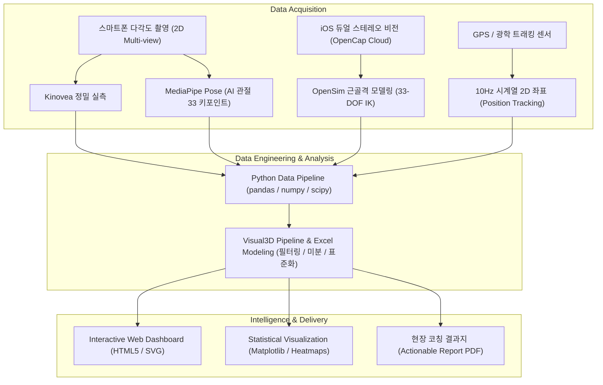

# 🏃‍♂️ KSPO 스포츠 영상분석 전문과정 (Sports Video Analysis)

> **2026년 국민체육진흥공단(KSPO) 스포츠인재아카데미 스포츠 영상분석 전문과정 공식 아카이브**  
> 영상 기반 2D/3D 마커리스 모션 캡처, 기능해부학 및 생체역학(Biomechanics), KBO 프로 야구 투구 분석, 스탠포드 OpenCap 기반 3D 동작분석, 축구 시계열 트래킹 데이터 엔지니어링 및 최종 성과물 포트폴리오 저장소입니다.

<p align="left">
  
  
  
  
  
  
</p>

<p align="left">
  
  
  
</p>

---

## 📌 Course Overview

- **교육명**: 2026년 체육인재양성 스포츠 영상분석 과정
- **주관/시행**: 서울올림픽기념국민체육진흥공단(KSPO) / (주)휴넷
- **교육 기간**: **2026. 10. 10.(토) ~ 11. 07.(토)** (매주 토·일요일 10:00~17:00, 총 9회차 / 54시간)
- **교육 장소**: 서울 송파구 올림픽공원 내 스포츠인재아카데미 2강의실
- **수료 기준**: 출석률 70% 이상 (54H 기준) + 최종 개인 발표 평가 60점 이상
- **교육 목표**: 
  - 2D/3D 광학 영상 장비 및 마커리스 컴퓨터 비전(Markerless CV) 기반 운동학·운동역학 데이터 수집 역량 확보
  - 인체 지레, 토크, 충격량, 키네마틱 시퀀스(Kinematic Sequence) 등 생체역학 법칙에 입각한 심층 동작 해석
  - 단순 수치 추출을 넘어 현장 지도자·선수를 설득할 수 있는 **1장짜리 처방형 결과지(Actionable Intelligence)** 작성 능력 체화

---

## 👨‍🏫 Instructors (강사진)

| 강사 | 프로필 & 전문 분야 | 담당 회차 |
|:---|:---|:---:|
| **변경석 박사 (Ph.D)** | • 스포츠과학 운동역학 전공 체육학박사<br/>• **現) 벡터바이오(VectorBio) 대표**<br/>• **現) KBO 프로구단(두산 베어스, SSG 랜더스, 삼성 라이온즈) 바이오메카닉스 분석 담당**<br/>• 現) 한국여자야구연맹(WBAK) 부회장 | **1~5회차, 8회차, 9회차**<br/>(스포츠 영상분석 기초·2D/3D 이론·축구 트래킹 및 야구 현장 적용) |
| **이효근 교수 (Ph.D)** | • 스포츠과학 신경역학 전공 이학박사<br/>• **現) 광운대학교 스포츠융합과학과 교수 (Applied Biomechanics Lab)**<br/>• 前) 벡터바이오 기업부설연구소장<br/>• 前) 미시간대학교 정형재활병원 연구원 | **6~7회차, 9회차**<br/>(Visual3D 모델링 & 파이프라인, OpenCap 셋업 및 복싱 3D 모션 분석) |

---

## 🗓️ 9-Day Detailed Curriculum

| 회차 | 일자 | 교육 주제 | 세부 교육 내용 및 실습 | 상태 | 디렉토리 |
|:---:|:---:|:---|:---|:---:|:---:|
| **1회차** | `10.10 (토)` | **스포츠 영상분석 기초** | • 스포츠영상분석 패러다임 변화 (연구실 → 현장 즉시 피드백)<br/>• KBO 구단 바이오메카닉스 사례 & 7단계 분석 프로토콜<br/>• 광학 파라미터(FPS, 셔터스피드, 조리개) & 지면반력(GRF) vs 족압 | ✅ 완료 | [📁 01_Basics](./01_Basics_of_Sports_Video_Analysis/) |
| **2회차** | `10.11 (일)` | **스포츠영상분석 자료수집 이론** | • 보행(Gait) 메커니즘 & 오픈소스 포즈 추정(OpenCV/AI)<br/>• 기능해부학 & 인체 3대 지레, 토크, 운동량·충격량 법칙<br/>• 투구 파워 에어리어/익스텐션 & Kinovea 기초 실습 | ✅ 완료 | [📁 02_Theory](./02_Data_Collection_Theory/) |
| **3회차** | `10.17 (토)` | **스포츠영상분석 자료수집 및 가공 (2차원)** | • Kinovea를 활용한 스쿼트(Squat) 무릎·발목 관절각 프레임 트래킹<br/>• 각속도(Angular Velocity), 가동범위(ROM) 엑셀 가공<br/>• `raw` & `Data processing` 시트 기반 동작분석표 템플릿 구축 | ✅ 완료 | [📁 03_2D_Data](./03_2D_Collection_and_Processing/) |
| **4회차** | `10.18 (일)` | **스포츠영상분석 결과지 작성 (2차원)** | • **3조 야구 투구 메커니즘 3인 비교분석 (우측면·전면·좌측면)**<br/>• Kinovea 수동 정밀 실측 vs MediaPipe Pose 33개 관절 교차 검증<br/>• 신장 표준화 지표(SFC, MKH, BR) 산출 및 [인터랙티브 웹 대시보드](./04_2D_Analysis_Report/04_pitching/) 제작 | ✅ 완료 | [📁 04_2D_Report](./04_2D_Analysis_Report/) |
| **5회차** | `10.24 (토)` | **스포츠영상분석 자료수집 및 가공 (3차원)** | • 스탠포드 OpenCap 마커리스 3D 모션캡처 아키텍처<br/>• OpenSim 근골격 모델링 결합 & 데이터 가치 사슬 (Data→Info→Intelligence)<br/>• OpenCap 현장 6대 촬영 원칙 & *OpenCap Monocular* 논문 심층 리뷰 | ✅ 완료 | [📁 05_3D_Data](./05_3D_Collection_and_Processing/) |
| **6회차** | `10.25 (일)` | **3차원 시스템 셋업 & 소프트웨어 심층** | • OpenCap 현장 셋업 시연 및 캘리브레이션 트러블슈팅 분석<br/>• **Visual3D** 심층 교육: CODA 골반 모델링, 분절 좌표계, 301개 파이프라인<br/>• 움직임 이론 (이벤트·페이즈, COM/BOS/COP 균형 패턴) & 진로 Q&A | ✅ 완료 | [📁 06_3D_Report](./06_3D_Analysis_Report/) |
| **7회차** | `10.31 (토)` | **스포츠영상 분석 적용 실습 (Part 1)** | • **스탠포드 OpenCap 복싱 3D 모션 분석 (STRAIGHT vs STRAIGHTx)**<br/>• 하체·골반 회전의 스트레이트 리치 기여도 규명 (**+9.8cm 차이, r=0.86**)<br/>• 키네마틱 시퀀스(골반→허리→팔꿈치) 분석 및 Python 파이프라인 구축 | ✅ 완료 | [📁 07_Practical_1](./07_Practical_Application_1/) |
| **8회차** | `11.01 (일)` | **스포츠영상 분석 적용 실습 (Part 2)** | • **축구 11인 시계열 트래킹 데이터(10Hz 2D 좌표) 속도·이동거리 분석**<br/>• 포지션별 활동량(LCM 5.69km, RCM 5.32km), 포메이션 지도 & 히트맵 시각화<br/>• 미분 노이즈와 필터링, 바이오메카닉스 현장 적용(해석·설득) 철학 | ✅ 완료 | [📁 08_Practical_2](./08_Practical_Application_2/) |
| **9회차** | `11.07 (토)` | **성과물 발표 및 수료** | • **개인별 최종 프로젝트 결과 보고서 및 슬라이드 발표**<br/>• 전문가 심사 및 피드백 수렴, 교육과정 수료 | ⏳ 예정 | [📁 09_Final](./09_Final_Project/) |

---

## 🏆 Key Practical Projects & Highlights

### 1. ⚾ [4회차] 야구 투구 메커니즘 3인 2D 다각도 비교분석
- **분석 대상**: 투수 3인(이상민, 신정환, 이준형)의 투구 동작 5회 반복 데이터
- **촬영 설계**: 스마트폰 3대를 동시 거치하여 우측면(1루측), 전면(본루측), 좌측면(3루측) FHD 동기화 촬영
- **분석 기법**: Kinovea 수동 정밀 실측 지표와 Python MediaPipe Pose(33개 관절 키포인트) 자동 추출값의 교차 검증
- **주요 성과**:
  - 신장 대비 표준화 지표 도출: 앞발 착지 보폭 비율(SFC %), 최대 무릎 거상 높이(MKH %), 볼 릴리스 높이(BR %)
  - 동작 일관성 평가: 변동계수(CV, Coefficient of Variation) 기반 메커니즘 안정성 비교
  - 산출물: 종합 결과지 PDF, 엑셀 분석표, **인터랙티브 웹 대시보드([`04_pitching/`](./04_2D_Analysis_Report/04_pitching/))** 구축

### 2. 🥊 [7회차] 스탠포드 OpenCap 기반 복싱 스트레이트 리치 기여도 3D 바이오메카닉스 분석
- **연구 질문**: *"하체와 골반의 회전 메커니즘은 복싱 스트레이트 펀치 리치(Reach)에 얼마나 기여하는가?"*
- **실험 설계**: 동일 피험자가 2가지 조건(STRAIGHT: 스텝 및 골반 회전 활용 vs STRAIGHTx: 하체 고정)으로 펀치 수행
- **사용 기술**: iOS 듀얼 스마트폰 스테레오 비전 + OpenCap 클라우드(HRNet + Triangulation + OpenSim 33-DOF 근골격 모델)
- **핵심 결과**:
  - **평균 리치 차이**: STRAIGHT(83.0cm, 신장의 53.6%) vs STRAIGHTx(73.2cm, 47.2%)로 **+9.8cm 유의한 리치 확장 달성 ($p < 0.001$)**
  - **기여도 분해**: 순수 팔 뻗음(어깨→손목) 길이는 52.0cm vs 51.7cm로 동일(차이 $\approx 0$). **리치 차이의 대부분(+9.5cm)은 골반·몸통 회전이 어깨를 전진시킨 데서 발생**
  - **상관관계**: 골반 회전각과 리치 간의 강력한 양의 상관성 확인 ($r = 0.86$, 골반 회전 10°당 리치 약 4.8cm 증가)
  - **키네마틱 시퀀스**: 가드 자세에서 타격까지 `골반 회전 → 몸통(허리) 회전 → 팔꿈치 신전`의 순차적 가속 메커니즘 규명
- **파이프라인**: Python `reach_analysis.py` 기반 TRC 3D 마커 좌표 및 OpenSim MOT 관절각 시계열 피크 자동 검출(`scipy.signal.find_peaks`)

### 3. ⚽ [8회차] 축구 11인 시계열 트래킹 데이터 기반 활동량 & 공간 점유 분석
- **데이터셋**: 4-3-3 포메이션 11인 선수의 45분간 10Hz 2D 트래킹 좌표 ($x, y$ 시계열, 총 27,000 프레임)
- **분석 지표**: 포지션별 평균 이동속도, 최고 속도, 총 이동거리 산출
- **핵심 결과**:
  - 중앙 미드필더진(LCM 5.69km, RCM 5.32km)과 윙어(RW 5.30km, LW 5.16km)의 가장 높은 활동량 확인
  - 수비형 미드필더(DM 4.01km)는 중심 축을 방어하며 미드필더 중 가장 낮은 이동거리를 기록
  - 좌표 미분 시 발생하는 고주파 노이즈(최고 속도 35~39km/h 과추정) 문제 규명 및 디지털 필터링(Butterworth Low-pass Filter) 적용 필요성 고찰
- **시각화 산출물**: Python Matplotlib 기반 포메이션 지도, 팀 전체 공간 점유 히트맵, 11인 개별 커버리지 히트맵 시각화

### 4. 🔬 [5회차] 최신 마커리스 모션캡처 연구 (*OpenCap Monocular*, 2026.03) 리뷰
- **원문**: *OpenCap Monocular: 3D Human Kinematics and Musculoskeletal Dynamics from a Single Smartphone Video* (Gilon et al., arXiv:2603.24733)
- **핵심 혁신**: 단 1대의 스마트폰 영상에서 컴퓨터 비전(WHAM)과 PyTorch 물리 기반 2단계 최적화, OpenSim 33-자유도 구속 모델을 결합하여 전신 운동학 및 동역학(GRF, 관절 모멘트) 복원
- **수학적 근거**: 발 미끄러짐(Foot Skating) 억제 손실 함수($L_{\text{foot slide}}$)를 통한 골반 드리프트 10배 감소(56.9cm → 4.9cm), 30°~45° 전측면 배치가 시상면/전두면 정보를 모두 보존하는 수학적 최적해임을 검증

---

## 📂 Repository Structure

```text
KSPO-Sports-Video-Analysis/
├── README.md                                  # 전체 커리큘럼, 핵심 성과물, 기술 스택 종합 로드맵
├── .gitignore                                 # 대용량 바이너리/영상 데이터 제외 설정
│
├── 01_Basics_of_Sports_Video_Analysis/          # [1회차 | 10.10]
│   ├── README.md                              # 스포츠 영상분석 기초 이론 & 7단계 분석 프로토콜
│   └── 2026-10-10_lecture-notes.md            # 1일차 강의 녹취 상세 요약 (광학 파라미터 & GRF)
│
├── 02_Data_Collection_Theory/                  # [2회차 | 10.11]
│   └── README.md                              # 보행 메커니즘, 기능해부학 3대 지레, 토크, 충격량 이론
│
├── 03_2D_Collection_and_Processing/            # [3회차 | 10.17]
│   ├── README.md                              # Kinovea 스쿼트 관절각 트래킹 & 엑셀 운동학 분석표 구축
│   ├── Squat.zip                              # 스쿼트 2D 실습 원본 데이터
│   ├── jump.zip                               # 점프 동작 실습 데이터
│   └── Vector 2D motion analysis.zip          # 2D 모션분석 템플릿
│
├── 04_2D_Analysis_Report/                      # [4회차 | 10.18]
│   ├── README.md                              # 야구 투구 동작 3인 2D 비교분석 종합 보고서
│   ├── 04_2026-10-18_2D_결과지작성_투구분석.md    # 4일차 투구분석 상세 실습 보고서
│   ├── 투구동작_비교분석.xlsx                    # Kinovea 실측 & MediaPipe 정규화 분석표
│   ├── 투구동작_비교분석_대시보드.pdf             # 3조 공식 발표용 종합 분석 결과지
│   ├── 투구동작_비교분석_사이트.html             # 웹 브리핑용 대시보드 단일 파일
│   └── 04_pitching/                           # 인터랙티브 투구 비교 웹 애플리케이션
│       ├── index.html                         # 인터랙티브 차트 & 비디오 싱크 대시보드
│       └── README.md                          # 대시보드 아키텍처 및 실행 가이드
│
├── 05_3D_Collection_and_Processing/            # [5회차 | 10.24]
│   ├── README.md                              # OpenCap 3D 마커리스 아키텍처 & 실전 6대 촬영 원칙
│   ├── OpenCap_Paper_Review.md                # 최신 Monocular 3D OpenCap 논문(arXiv:2603.24733) 심층 리뷰
│   ├── 2026-10-24_lecture-notes.md            # 5일차 강의 상세 요약
│   └── papers/                                # 참고 학술 논문 PDF 아카이브
│
├── 06_3D_Analysis_Report/                      # [6회차 | 10.25]
│   ├── README.md                              # OpenCap 셋업 트러블슈팅 & Visual3D 분석 개요
│   └── 2026-10-25_OpenCap셋업_Visual3D.md     # Visual3D CODA 모델링, 301개 파이프라인, 움직임 이론
│
├── 07_Practical_Application_1/                 # [7회차 | 10.31]
│   ├── README.md                              # OpenCap 복싱 3D 모션 분석 보고서 (리치 기여도 규명)
│   ├── analysis/                              # Python 3D 생체역학 데이터 처리 스크립트
│   │   ├── reach_analysis.py                  # TRC/MOT 파싱, 피크 검출, 리치 분해 및 시각화 코드
│   │   └── requirements.txt                   # 필수 라이브러리 (numpy, pandas, scipy, matplotlib)
│   ├── data/opencap/                          # 익명화된 OpenCap 원천 3D 데이터
│   │   ├── MarkerData/*.trc                   # 3차원 마커 공간 좌표 시계열 (60Hz)
│   │   ├── OpenSimData/Kinematics/*.mot       # 관절 각도 시계열 역운동학 데이터
│   │   └── OpenSimData/Model/*.osim           # 맞춤 스케일링된 33-DOF 근골격 모델
│   ├── results/                               # 정량화 분석 결과 및 통계 표
│   │   ├── punches.csv                        # 펀치별 리치 분해 및 관절 회전 측정값
│   │   ├── summary.csv                        # 조건별 평균 및 통계 검정 결과
│   │   └── figures/*.png                      # 리치 분해 차트, 상관관계 산점도, 관절각 시계열 그래프
│   └── notes/                                 # 7일차 강의 노트 및 OpenCap 세션 시행착오 일지
│
├── 08_Practical_Application_2/                 # [8회차 | 11.01]
│   ├── README.md                              # 축구 트래킹 분석 & 바이오메카닉스 현장 적용 심화
│   ├── analysis/                              # Python 축구 트래킹 분석 스크립트
│   │   └── soccer_analysis.py                 # 10Hz 좌표 기반 속도·거리 산출 및 히트맵 렌더링 코드
│   ├── data/                                  # 축구 11인 시계열 좌표 원천 데이터
│   ├── results/                               # 포지션별 활동량 요약 CSV 및 시각화 그림
│   │   ├── position_summary.csv               # 포지션별 평균속도, 최고속도, 이동거리 통계표
│   │   └── figures/*.png                      # 포메이션 맵, 팀 전체 히트맵, 11인 개별 커버리지 히트맵
│   └── notes/                                 # 8일차 강의 요약 및 엑셀 수식 계산 가이드
│
├── 09_Final_Project/                           # [9회차 | 11.07]
│   └── README.md                              # 최종 개인 발표 프로젝트 개요 및 발표 슬라이드
│
└── docs/                                       # 공식 공고문, 교육과정 규정 및 참고 매뉴얼
```

---

## 🛠️ Tech Stack & Analytics Ecosystem



| 분류 | 세부 기술 및 도구 | 주요 활용 영역 |
|:---|:---|:---|
| **모션 캡처 & 비전** | **OpenCap**, **MediaPipe Pose**, **Kinovea** (v0.9.5), iOS Dual-Camera Stereo | 2D/3D 마커리스 자세 추정, 키포인트 트래킹, 공간 캘리브레이션 |
| **근골격 역학 & 모델링** | **OpenSim** (33-DOF Musculoskeletal Model), **Visual3D** (C-Motion) | 역운동학(IK), CODA 골반 모델링, 관절 상대각도 연산, 301개 파이프라인 |
| **데이터 엔지니어링** | **Python** (`pandas`, `numpy`, `scipy.signal`), **Microsoft Excel** | 시계열 신호 정제, 피크 검출, 노이즈 필터링(Butterworth), 수치 미분 |
| **시각화 & 브리핑** | **Matplotlib**, HTML5/SVG 인터랙티브 대시보드, PDF Report | 공간 점유 히트맵, 키네마틱 시퀀스 그래프, 현장 브리핑용 요약지 |

---

## 💡 Core Philosophy & Insights

> *"모션 캡처 데이터를 수집하여 각도를 뽑는 것은 컴퓨터 비전 AI가 가장 잘하는 영역입니다.  
> 바이오메카니스트의 본질적인 경쟁력은 **'이 숫자가 선수에게 어떤 물리적·기능적 의미를 가지는가'**를 해석하고, 코칭스태프와 선수가 납득할 수 있는 언어로 **현장을 설득하는 소통 능력**에 있습니다."*  
> — *강의 핵심 메시지 종합 (변경석 박사 & 이효근 교수)*

1. **데이터 가치 사슬 (Data Hierarchy)**:
   - **Data (원천 데이터)**: 시계열 픽셀 좌표 및 마커 위치
   - **Information (정제된 정보)**: 관절 각도, 각속도, 신장 대비 스트라이드 비율
   - **Intelligence (역학적 해석)**: 지면반력 전달 효율, 관절 토크 및 부상 위험도 평가
   - **Actionable Solution (현장 처방)**: 부상 예방을 위한 투구 궤적 수정, 펀치 리치 증대를 위한 골반 회전 보강
2. **표준화(Normative Data)의 경계**:
   - 신체 중심 이동 속도나 스프린트 시간 등 **선운동(Linear)** 지표는 표준화가 가능하지만, 관절 회전 각도나 스트라이드 등 **각운동(Angular)** 메커니즘은 개인의 해부학적 특성(골격 길이, 유연성)에 맞춘 개별화 접근이 필수적입니다.
3. **신호 처리와 필터링의 중요성**:
   - 위치 데이터를 단순 차분(미분)할 경우 고주파 노이즈가 증폭되어 최고 속도나 각가속도가 과추정됩니다. 차단 주파수(Cut-off frequency)를 고려한 Butterworth 필터링 등 신호 처리 절차의 정밀한 통제가 신뢰도의 생명입니다.

---

## 👤 Author

- **이준형 (Junhyeong Lee)**
- **GitHub**: [@leejunhyeong-02](https://github.com/leejunhyeong-02)
- **Email**: wnsgu02@naver.com
- **Interests**: Sports Biomechanics, Computer Vision, Deep Learning Pose Estimation, Kinematics Data Engineering
